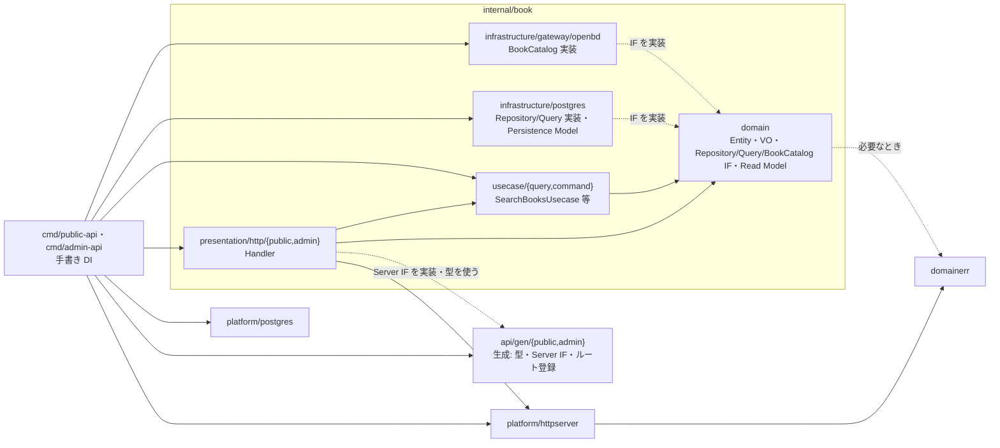
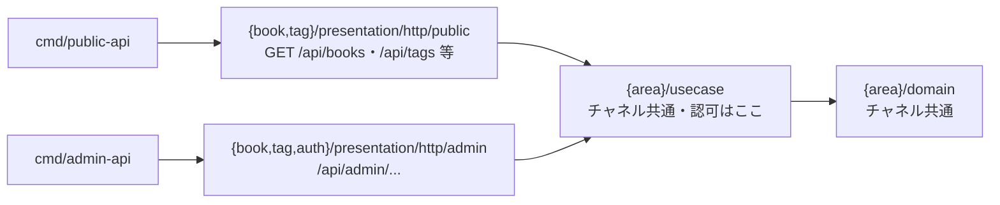

# バックエンド方針

## 文書の分担（MECE）

| 文書 | 管轄 |
|---|---|
| [`docs/architecture.md`](../docs/architecture.md) | リポジトリ全体の方針・チャネル境界・API 契約（`openapi/`）の配置と規則 |
| **本書** | バックエンドのスタック・層・HTTP（OpenAPI からの BE 生成）・ディレクトリ・永続化 |
| [`frontend/architecture.md`](../frontend/architecture.md) | フロントのスタック・設計。OpenAPI **生成物の利用**のみ |

人が読む方針は **日本語**（AI 入口は `CLAUDE.md` / `AGENTS.md`）。

## 1. 決定（要約）

| 項目 | 決定 |
|---|---|
| 形 | **Go モノリス**（1 `go.mod`）。実行サービスはチャネルごとに 2 つ（`cmd/public-api` :8080 / `cmd/admin-api` :8081）。業務ロジックは共有し、配線と公開ルートだけが違う |
| HTTP | **Echo** |
| 設計 | **オニオン** + DDD 戦術 + **CQRS**（単一 DB。全体 Event Sourcing はしない）。`internal/` の第一階層は**業務領域別**、層は領域の中（§2） |
| 永続化 | **PostgreSQL + GORM**（現在状態が正）。**GORM AutoMigrate は使わない** |
| マイグレーション | **golang-migrate**（`backend/migrations/` が SQL の正。アプリ起動時 migrate しない） |
| HTTP / OpenAPI | Echo。**OpenAPI Design First**: `openapi/` の YAML が正で、oapi-codegen で HTTP 境界（型・Server IF・ルート登録）を生成。入力検証は kin-openapi（§3） |
| FE 契約 | FE は同じ `openapi/dist/` から Orval で生成（手編集禁止・CI ドリフト検知） |
| 書誌・書影 | 外部カタログ。Domain の `bookdomain.BookCatalog`（ExternalGateway）を `book/infrastructure/gateway/openbd` が実装する。画像は保存せず提供元の URL を返す。openBD に書影が無ければ書影なし。採用理由: 書影の取得元を 1 つに絞ると、取得元ごとの保持期限・削除依頼に合わせる仕組みが要らず、登録と更新のたびに取り直せば提供元の変更が反映されるため |
| 認証 | 管理（`/api/admin`）はログイン済みのサーバー側セッション（httpOnly Cookie `admin_session`）。閲覧は認証なし。採用理由: 利用者が自分 1 人なので、外部の ID 基盤やユーザー管理を持たず、ID とパスワードのハッシュを環境変数に置き、失効をサーバー側で即座に効かせられる形にした。脅威ごとの対策（総当たり・CSRF・セッション固定）は `docs/design/admin-screens.md` |
| ツールチェーン | **mise で Go 版を固定**（リポジトリ直下 `.mise.toml`。`go.mod` と揃える） |
| ローカル開発 | API は**ホストの Go**、DB は **Docker Compose**。Dev Container なし |
| 本番イメージ | `Dockerfile.api`（`--build-arg CMD=public-api\|admin-api`）で build する形だけを持つ。デプロイはしない（要求）ので、日常開発では API をコンテナ起動しない |

業務ルールの真実は 1 つ。ビジネスロジックをチャネルごとに複製しない。マイクロサービス分割はしない。

### 1.1 ローカル開発

| 対象 | どう動かすか |
|---|---|
| Go 本体 | `mise install`（`.mise.toml` の `go`）→ ホストで `go run` / `make run-public` / `make run-admin` |
| PostgreSQL | `docker compose up -d`（`backend/docker-compose.yml`） |
| migrate | ホストの `golang-migrate`（`make migrate-up`）。アプリ起動時には走らせない |
| API コンテナ | **日常開発では使わない**（本番用 Dockerfile の検証時のみ） |

Dev Container で IDE ごとコンテナに閉じ込める方式は採らない。

## 2. 層と依存

`internal/` の第一階層は **業務領域（area）別**（Package by Feature）。オニオンの各層は **領域の中** に置き、チャネル（public / admin）の差は **領域内の `presentation/http/<channel>`** で分ける。技術基盤は `platform/`、共通のエラー分類は `domainerr/` に置く。1 つの業務変更で触るファイルをできるだけ 1 つの領域ディレクトリに局所化し、領域の境界をディレクトリから読めるようにするため（領域をまたぐ連携は下の「領域間のルール」に従う）。レイヤー別（`internal/<layer>/<area>/`）は 1 つの変更が層の数だけのディレクトリに分散するため、チャネル別（`internal/<channel>/` + `shared`）は業務ルールがチャネルの数だけ複製されるか、所有者の曖昧な共通コードが集まるため採らない。

```text
internal/
  <area>/                          # 業務領域（book / tag / auth）
    presentation/http/<channel>/   → usecase/{command,query}/ → domain/
    infrastructure/{postgres,gateway,bcrypt}/ ──（domain の IF を実装）──↗
  platform/{httpserver,postgres}/  # 技術基盤（業務ルールを持たない）
  domainerr/                       # ErrNotFound 等（stdlib のみ）
```

**存在しない層は作らない**。必要になった時点で追加する（例: `tag` は外部連携が無いので `infrastructure/gateway/` を持たない）。

### 領域内の依存関係（book）

import の向きと実行時の呼び出し方向は別物: Infrastructure は Domain の IF を **実装** する（import は Infrastructure → Domain）。`cmd` は外側の組み立て役なので具象を知ってよい。



| 場所 | 責務 | 禁止事項 |
|---|---|---|
| `<area>/domain` | Entity／VO／業務不変条件。**Repository IF**／**Query IF**／**ExternalGateway IF**（外部 API 連携の抽象）と Read Model | Echo・GORM・SQL・DB 固有型・外部 SDK・HTTP Request／Response への依存 |
| `<area>/usecase/command` | 更新シナリオ。**業務上の認可**・Tx 境界・Command DTO → Domain Model 変換・相関ルールの判定 | HTTP DTO・ORM model の持ち込み、業務ルールの重複 |
| `<area>/usecase/query` | 参照シナリオ。Read Model の取得・整形 | 更新系 Domain Model の無理な流用 |
| `<area>/infrastructure/postgres` | Repository／Query 実装と Persistence Model（`gorm` タグ） | 業務ルールの実装、他領域から直接呼ばれる API 化 |
| `<area>/infrastructure/gateway` | ExternalGateway 実装（外部 API 呼び出し） | 同上 |
| `<area>/presentation/http/<channel>` | 生成 Server IF のうち担当分の実装（生成型 ↔ UseCase の入出力の変換）・認証結果の取り出しと受け渡し | **業務上の認可**・状態遷移・永続化 |
| `platform/httpserver` | Echo 初期化・OpenAPI の入力検証（`ValidateRequest`）と違反の変換・`HTTPErrorHandler`・`ErrorResponse`・operation ごとの認証の middleware・graceful shutdown | 業務領域固有のルール、チャネル別の生成物の import |
| `platform/postgres` | DB 接続・プール設定 | 同上 |
| `domainerr` | `ErrNotFound` / `ErrInvalid` / `ErrConflict` / `ErrUnauthorized` / `ErrTooManyAttempts` の最小限の分類、業務ルール違反のコード（`CodedError`）、相関ルールの違反の集まり（`Violations`）。stdlib のみ | 業務ロジック・外部技術への依存 |

- Domain Service はエンティティに載せにくい業務ルール
- 命名目安: UseCase は IF `RegisterBookUsecase` + 公開の実装 `RegisterBookUsecaseImpl`、Handler は `Handler`（Request／Response 型は生成物を使い `dto.go` は作らない。§3）（詳細は下記「配置と命名のルール」）
- `cmd/*/main.go` で手書き DI（コンテナなし）: config → platform → infrastructure → usecase → presentation
- 外部 API 呼び出しは UseCase から **ExternalGateway IF**（Domain 定義）経由で行う。Repository／Query と同じ理由（Domain が具体的な HTTP クライアント実装に依存しないため）で Domain に IF を置く

### 領域間のルール

- 他領域の `infrastructure`・Persistence Model を import して操作しない（実例: 本の登録が分野タグの存在を確かめるときは、`tag/domain` の Query IF を UseCase に注入する）
- 領域間の import 禁止は機械的に検査していない（レビューで確認する）。golangci-lint の `depguard` で強制するかは未決
- 複数領域にまたがる UseCase は、**どの領域が責任を持つか** を設計レビューで決め、相手領域の公開された入口（UseCase／Domain IF）を通じて連携する。複数領域のインフラを UseCase から直接触らない
- `internal/shared` や `common` に、業務の所有者が曖昧なコード（`BookService` 等）を集めない。`platform` / `domainerr` は技術基盤と最小限のエラー分類に限る
- 業務ルールをチャネル別に複製しない（`internal/admin/domain` のような構成にしない）

### 配置と命名のルール（迷ったらここを写す）

- Go のパッケージ名はディレクトリ名と一致させる（`domain` / `query` / `command` / `postgres` / `public` / `admin`）
- 複数領域・複数層を import する側（`cmd` 等）は `<area><役割>` の別名を付ける（例: `pgbook`・`bookqry`・`bookcmd`・`bookpublic`・`bookadmin`、基盤は `pgplatform`）
- チャネル名は Go でも `public` / `admin`。URL は `/api/...`（public）と `/api/admin/...`（admin）、実行ポイントは `cmd/public-api` / `cmd/admin-api`
- **`Impl` は IF と実装が同じパッケージにあるときだけ付ける**（Handler は UseCase の実装ではなく IF に依存するので、UseCase の実装を変えても Handler は変わらない。Infrastructure は IF を返す `NewXxx` だけを公開するので、呼び出し側は Domain の IF にしか依存できず、DB の実装を変えても影響が外に広がらない。`Impl` を付ける条件を「IF と実装の名前が同じパッケージで衝突するとき」の 1 つに決めておくことで、命名に迷わず全領域で同じ形になる）
  - UseCase: 同じパッケージに IF `SearchBooksUsecase` と公開 struct `SearchBooksUsecaseImpl` を置き、`cmd` で struct リテラル（`&bookqry.SearchBooksUsecaseImpl{Books: ...}`）から組み立てる
  - Infrastructure: IF は Domain にあるので名前は衝突しない。非公開 struct + IF を返す `NewXxx`（`NewQuery(db) domain.Query`）で作り、`Impl` は付けない
- ファイル名は小文字（区切りは `_`）。領域名や `_impl` を付けない（ディレクトリで分かるため）。`_linux` / `_js` 等の OS・アーキテクチャ名で終わらせない（Go のビルド制約として解釈される）。テストは `_test.go` にし、テスト以外のファイルを `_test` で終わらせない（`go build` の対象外になる）。例: `search_books.go` / `search_books_test.go` / `query.go` / `repository.go`
- 会話・レビューでは同名を区別するためパッケージ名付きで呼ぶ（`domain.Query` = IF、`postgres.NewQuery` = 実装、`query.SearchBooksUsecase` = UseCase）
- テストは対象と同じディレクトリに置く（[テスト規約](../docs/rules/testing.md)）
- **新しい業務領域の追加・境界の変更は設計レビュー対象**。要件と実際の変更理由から決め、予測で空パッケージを量産しない。ディレクトリは `internal/book` を写し、今必要な層だけ作る

### 型・メソッドの名前の付け方

名前は下の「設計原則」の目的駆動名前設計に従い、技術的な手段ではなく業務上の目的・振る舞いから付ける。用語は要件（[`docs/requirements/status-map.md`](../docs/requirements/status-map.md)）と同じ言葉（ユビキタス言語: 本・分野タグ・一言まとめ・感想・評価・書影・書誌）を使う。

**UseCase**

- 型名は `<動詞><業務対象>Usecase`（綴りは `Usecase` のまま。`UseCase` にしない）。パッケージ名が `query` / `command` で業務領域が呼び出し側から見えないため、型名に業務対象（`Book` / `Tag` 等）を入れる
- 単純な登録・参照・更新・削除は `Create` / `Read` / `Update` / `Delete`。業務上の意味を持つ操作は業務の動詞（`Register` / `Rename` / `Login` / `Logout` / `LookupCatalog`）にし、CRUD に寄せない
- `Read` は 1 件の参照だけに使う（`ReadBookUsecase`）。一覧は、利用者が条件を指定するかどうかに関係なく `Search` にし、業務対象を複数形にする（`SearchBooksUsecase`）。`List` や `Read` + 複数形（`ReadBooksUsecase`）は使わない（1 件と一覧が末尾の `s` だけで分かれて取り違えやすく、一覧の動詞を 1 つにして迷わないため）。複数形は複数件を返すことだけを表し、全件を返すとは限らない（ページング・並び順・取得範囲は契約に書く）
- UseCase の名前を Repository／Query のメソッド名から決めない
- ファイル名は型名から `Usecase` を除いた snake_case（`search_books.go` / `rename_tag.go`）

| 業務の目的 | UseCase の型名 |
|---|---|
| 読んだ本を 1 件参照する | `ReadBookUsecase` |
| 読んだ本の一覧を参照する（検索・絞り込みを含む） | `SearchBooksUsecase` |
| 読んだ本を登録・更新・削除する | `RegisterBookUsecase` / `UpdateBookUsecase` / `DeleteBookUsecase` |
| 分野タグの名前を変える | `RenameTagUsecase` |
| 分野タグごとの冊数を数える | `CountBooksUsecase` |
| ログインする | `LoginUsecase` |

**Repository／Query のメソッド（取得）**

取得は `Find` を基本にし、目的が違うときだけ `Search` / `Count` / `Exists` を使う。同じ意味の取得に `Read` / `Get` / `Find` を混ぜない（UseCase の `Read` は業務の目的、Repository／Query の `Find` はデータの取得で、層の責務が違うため名前も違う）。

| 目的 | 名前 | 使う条件 |
|---|---|---|
| 一意なキーで 1 件 | `FindByID` / `FindDetailByID` | 条件が一意のときだけ。一意でない条件で 1 件を暗黙に選ばない |
| 全件 | `FindAll` | 全件を返す契約のときだけ |
| 固定の条件に合うものを全件 | `FindAllByTagID` | 一致したものを**すべて**返すときだけ。ページングした一部には使わない |
| 利用者が変えられる条件での検索 | `Search(criteria, range)` | キーワード・複数の絞り込み・ページングなど。`WHERE` があるだけでは使わない。件数が多くなりうる取得もこれで返す範囲を契約にする |
| 件数 | `CountBooks` / `CountByXxx` | 数値を返す |
| 存在するか | `ExistsByISBN` / `ExistsByName` / `ExistsAll` | `bool` を返す |

Query（読み取り側）は Read Model を返し、業務の状態を変えない。Repository の更新系は `Create` / `CreateAll` / `Update` / `Delete`（現在の実例）。

**Domain**

- Entity・集約・VO は業務の概念で名付け（`Book` / `Tag` / `ISBN` / `Review`）、`BookData` / `TagEntity` のような技術のサフィックスを付けない。種類が違うだけで Entity を機械的に分けない（業務の目的・不変条件・ライフサイクル・変更理由で判断する）
- メソッドは業務の振る舞いにする（`book.RefreshCatalog()` / `tag.Rename()`）。`UpdateStatus()` / `Process()` に業務の意味を隠さない。不変条件は状態を変えるメソッドの中で守る（事前に `Validate` を呼ばないと安全にならない形にしない）
- 判定は `bool` を返す `CanXxx`（操作できるか）/ `IsXxx`（状態）/ `HasXxx`（持っているか）、検証は `error` を返す `Validate` / `ValidateForXxx`。すべての型に `Validate` を付けない（VO の生成条件は `NewXxx` で保証する）。過去分詞は状態の判定に使ってよい（`IsExpired()`）

**operationId との関係**

`operationId`（[`docs/architecture.md`](../docs/architecture.md) §4）は、その operation が呼ぶ UseCase の型名から `Usecase` を除いた lowerCamel にする。Handler のメソッド名も同じになる（`SearchBooksUsecase` → operationId `searchBooks` → Handler `SearchBooks`）。UseCase の名前を先に上の規則で決め、operationId はそれに従わせる（`list` / `get` のような HTTP 寄りの動詞に置き換えない）。

| API の操作 | UseCase | operationId |
|---|---|---|
| 1 件の参照 | `ReadBookUsecase` | `readBook` |
| 一覧の参照（検索・絞り込みを含む） | `SearchBooksUsecase` | `searchBooks` |
| 登録・更新・削除 | `RegisterBookUsecase` / `UpdateBookUsecase` / `DeleteBookUsecase` | `registerBook` / `updateBook` / `deleteBook` |
| 業務の意味を持つ操作 | `RenameTagUsecase` | `renameTag` |

### 層ごとの規則一覧（決まっていること）

層ごとに散らばっている規則の索引。正は各節（命名は本節の上、HTTP は §3、テストは [テスト規約](../docs/rules/testing.md)）。「実例」は現在のコードにあるもの。

| 層 | 置き場・ファイル名 | 型・関数の命名 | テスト |
|---|---|---|---|
| **Domain** | `<area>/domain/`。Entity と IF は `<area>.go`、VO は概念ごとのファイル（実例: `book/domain/{book,isbn,review,summary,title,list_range}.go`、`tag/domain/{tag,name}.go`、`auth/domain/{session,credentials}.go`） | 読み取り IF `Query`・書き込み IF `Repository`（呼ぶときは `domain.Query`）。取得のメソッドは `Find` が基本で、目的が違えば `Search` / `Count` / `Exists`（上の「型・メソッドの名前の付け方」）。外部連携の IF は業務の能力で名付ける（実例: `BookCatalog`、`PasswordVerifier`）。Read Model は `XxxDetail` / `XxxList` / `XxxListItem` / `XxxSummary` など用途が分かる名前（実例: `BookDetail`、`TagListItem`）。VO の不変条件はコンストラクタ `NewXxx` がエラーを返して保証する | DB・HTTP に依存しない。不変条件・業務ルール・状態遷移・境界値と、不正な状態を作れないこと |
| **UseCase（参照）** | `<area>/usecase/query/`。1 UseCase 1 ファイルで、ファイル名は `<動詞>_<業務対象>`（実例: `book/usecase/query/{read_book,search_books,lookup_catalog}.go`） | IF `SearchBooksUsecase` + 公開 struct `SearchBooksUsecaseImpl`、メソッドは `Execute`、依存は公開フィールド（`Books domain.Query`）。`cmd` で struct リテラルから組み立てる | 手書き Fake を注入し DB 無しで動かす。下位層のエラーが伝播すること |
| **UseCase（更新）** | `<area>/usecase/command/`（実例: `book/usecase/command/{register_book,update_book,delete_book}.go`） | IF `RegisterBookUsecase` + `RegisterBookUsecaseImpl`。データを持つ入力は Command DTO `RegisterBookCommand`（UseCase の名前から `Usecase` を除き `Command` を付ける）、ID だけなら scalar 引数 | 参照と同じに加え、失敗時に状態が変わらないこと、入力エラー時に下位層が呼ばれないこと、相関ルールの違反がすべて同時に返ること |
| **Infrastructure（DB）** | `<area>/infrastructure/postgres/`。実装は `query.go` / `repository.go`、Persistence Model（`gorm` タグ）は同じファイルの非公開 `model` | 非公開 struct（`query` / `repository`）+ Domain の IF を返す `NewQuery` / `NewRepository`。`Impl` は付けない。**Repository・Query の実装は型と各メソッドに日本語で概要の 1 行コメント**（ほかの層も含め [コメントの書き方](../docs/rules/code-comments.md)） | SQL が複雑なとき（JOIN・サブクエリ・集計・ロックやトランザクション・DB 固有の機能）は、実際の PostgreSQL への契約テスト（DB に繋がらなければ失敗）。書く場合、Query は Read Model への詰め替えと、書き込み側の型（Entity・VO）に依存しないこと |
| **Infrastructure（外部連携）** | `<area>/infrastructure/gateway/<提供元>/`（実例: `book/infrastructure/gateway/openbd/catalog.go`）。ハッシュ照合は `auth/infrastructure/bcrypt/` | Domain の ExternalGateway IF を実装する。実装には提供元の名前を使ってよい | 外部サービスの mock（`httptest`）に対する契約テスト |
| **Presentation** | `<area>/presentation/http/<channel>/handler.go`（実例: `book/presentation/http/{public,admin}/`） | struct `Handler`、メソッド名は operationId（`searchBooks` → `SearchBooks`）、依存は公開フィールドで、名前は UseCase の型名を略さずに使う（`SearchBooksUsecase`。`ListUC` のように略さない）。Request／Response は生成型（`publicapi.*` / `adminapi.*`）を使い `dto.go` は作らない | `handler_integration_test.go` に 1 本化（Fake の Handler テストは書かない）。`cmd` と同じ部品を実際の DB で組み立て、API が返しうるステータスごとに最低 1 件。すべてレスポンスを spec で検証し、YAML に書いた入力の制約は 1 つにつき通る値と弾かれる値の 1 組を検証 |
| **cmd** | `cmd/<service>/main.go`（設定・DB 接続・起動）・`server.go`（Handler の束ねと組み立て関数 `buildEcho`）。`cmd/public-api/sample_data.go`（見本データ） | `server` struct に各領域の Handler を埋め込み `var _ <channel>api.ServerInterface = (*server)(nil)`。入力検証・ルート登録・Handler の組み立ては `buildEcho(spec, 依存)` に置き、`run` は DB 接続と依存の生成・起動だけにする。import の別名は `<area><役割>`・`<channel>api` | Server IF の実装漏れは `var _` でコンパイル時に検出する。`main_test.go`（in-package）で、`buildEcho` に Fake を渡してルートの応答（依存の nil・登録漏れ）と入力検証の middleware の登録（spec 違反が 400）を検証する |
| **platform / domainerr** | `platform/{httpserver,postgres}/`、`domainerr/` | 業務の分類エラーは sentinel `ErrNotFound` / `ErrInvalid` / `ErrConflict` 等。コード付きは `domainerr.New(kind, code, message)`（HTTP への変換は `HTTPErrorHandler` だけ） | 入力検証の変換はテスト用 spec で網羅（各 Handler で繰り返さない） |
| **全層共通** | ファイル名は小文字・`_` 区切り。領域名・`_impl` を付けない | パッケージ名 = ディレクトリ名。会話ではパッケージ名付きで呼ぶ | 対象と同じディレクトリ。原則は外部テストパッケージ `<対象>_test`（非公開シンボルの検証が必要なときだけ in-package を許し、理由をファイル冒頭に書く）。入力違いはテーブルドリブン。DB・環境変数・グローバル状態を共有しないテストには `t.Parallel()`。テスト名は期待する振る舞い |

### 未決の規則（初めて作るときに決める）

まだ実例が無いか、現在のコードで書き方が揃っていないもの。該当する実装が初めて出る PR の設計レビューで決め、決めたら上の一覧と各節に反映する。推測で先に決めない。

| 層 | 決めること |
|---|---|
| Domain | Entity・集約のファイルの分け方（Entity と VO を同じファイルに置くか）／ID の型（数値の型か VO か）／英米の綴り（`Canceled` / `Cancelled`） |
| UseCase（更新） | トランザクションの張り方（UseCase にどう Tx を渡すか。現在は Repository の 1 メソッドの中で完結）／Command DTO を UseCase と同じファイルに置くか |
| Infrastructure | Persistence Model と Domain の変換関数の命名（候補は `toDomain` / `toPersistenceModel`）／1 パッケージに複数テーブルの model が出たときの命名 |
| Presentation | path・query パラメータの生成型から UseCase の入力への変換の書き方 |
| テスト | Fake の置き場（各テストファイルに書くか、共有のテスト用パッケージを作るか）／DB を使うテストの並列実行（現在はパッケージを直列に実行。[テスト規約](../docs/rules/testing.md)）／テストデータの作り方（fixture か builder か）／テスト関数名の書き方（現在は `TestRepository_FindByID_NotFound` のような英語と、日本語の振る舞いのものが混在） |

### 設計原則（目的駆動）

- **目的駆動名前設計**: 名前は「存在」ではなく「目的」で付ける。1 手段に対して目的は 1 つ
- **1 クラス 1 目的**: 目的が増えるほど変更の影響が広がる。目的ごとに分離する（例: 本の新規登録と更新で入力・検証が異なるので `RegisterBookCommand` / `UpdateBookCommand` と UseCase を分けている）
- 共通化より「変更理由の分離」を優先する（似ているだけの処理を無理に1つへまとめない。「同じ理由で変更されるか？」で判断し、`Common` / `Util` / `Manager` / `Helper` / `BaseService` のような曖昧な共通クラスを安易に作らない）
- **Domain は外部技術に依存しない**（§2 表の「禁止事項」の具体化）: Web Framework（Echo）／Controller／Request・Response／ORM（GORM）／SQL／DB 固有型／外部 API SDK／Infrastructure 実装のいずれも Domain から直接参照しない。外部との通信が要るときは Repository／Query／ExternalGateway の Interface を経由する
- **業務ルールは Domain（VO・Entity）に閉じ込め、不正な状態を生成できない設計を優先する**: 呼び出し側の複数箇所に同じ範囲チェックを書く（例: `if rating >= 1 && rating <= 5` があちこちに存在する）のではなく、VO のコンストラクタ1箇所で不変条件を保証する（本リポジトリでは `NewRating` が 1〜5、`NewComment` が 1〜5000 文字を保証する）
- **モデルは目的ごとに区別し、構造を無理に一致させない**: 同じ「本」でも
  - **Domain Model**（業務ルールを表現。例: `book/domain.Book` + `Title` VO）
  - **Read Model**（参照専用に最適化。例: `book/domain.BookDetail` / `BookListItem`。命名は `XxxView` / `XxxReadModel` / `XxxListItem` / `XxxSummary` など用途が伝わるものでよい）
  - **Persistence Model**（DB 永続化専用。例: `book/infrastructure/postgres.model`、`gorm` タグ付き）
  はそれぞれ別目的であり、DB テーブル構造をそのまま Domain Model として扱ってはならない

変更容易性 = 影響範囲が局所化され、関係ない機能が壊れにくい状態

### CQRS（Repository と Query）

| | 書き込み側 | 読み取り側 |
|---|---|---|
| Domain IF | `<area>/domain.Repository` | `<area>/domain.Query` |
| UseCase | `<area>/usecase/command` | `<area>/usecase/query` |
| Infrastructure | `<area>/infrastructure/postgres.NewRepository` | `<area>/infrastructure/postgres.NewQuery` |

- 同一テーブルを両方から触ってよい（実装を1 struct にまとめて両方の IF を満たしてもよい）
- DB は1つ（アプリでの Writer/Reader 必須分離はしない）
- イベント／投影は必要なドメインだけ。分散イベントバス・全体 ES はしない
- 本と分野タグの対応（`book_tag`）の入れ替えなど厳密整合は同一トランザクションの Command
- **Repository / Query / ExternalGateway の IF は Domain に置く**。理由: 「Domain は外部に依存しない」原則を保つため、外部リソース（DB・外部 API）への抽象 IF はすべて Domain 定義・Infrastructure 実装とする。種類によって置き場を分けると「なぜ Repository と Query で層が違うのか」という判断の再調査コストが生じるため、一貫性を優先
- **更新系**: 境界は **Command DTO**（`<area>/usecase/command` が定義。例: `RegisterBookCommand` / `UpdateBookCommand`）で受け渡す。UseCase 内で DTO → ドメインモデル（Entity/Aggregate）へ変換してから Repository に渡す
  - Presentation の Request 構造体・ORM Entity・DB Entity・Framework 依存オブジェクト（`echo.Context` 等）を UseCase／Domain へ直接渡さない。Handler は Request から値を取り出して Command DTO を組み立てる
  - Command DTO 自身に業務ロジック（バリデーション・状態遷移・DB／外部 API アクセス）を書かない。責務はデータの受け渡しのみで、判定は Domain（VO のコンストラクタ等）に置く
  - **例外**: Delete など ID のみを受け取る操作は Command DTO 不要（scalar 引数のまま）。判断基準は入力の形状 — データフィールドを持つなら DTO、ID のみなら scalar。業務ルール・入力制約（存在確認・認可など）の有無は DTO の要否とは別に扱い、いずれの場合も判定は Domain／UseCase に置く
  - 基本フロー: Handler → Command DTO → UseCase → Domain Model → Repository／ExternalGateway（例: `adminapi.RegisterBookRequest` → `RegisterBookCommand` → `RegisterBookUsecase` → `Book`）
- **参照系**: **Read Model**（参照専用モデル）中心で設計する。表示・検索用途に最適化した形を返し、更新系 DTO やドメインモデルを無理に再利用しない
  - 基本フロー: Handler → Query UseCase → Query IF → Read Model
  - Read Model は Domain Model や DB テーブルと同じ構造にする必要はない。DB Entity（Persistence Model）をそのまま API レスポンスにしない
- 更新モデルと参照モデルを混在させない（同じ struct を両方の用途に使い回さない）

### チャネル

- path: `/api/...`（public）、`/api/admin/...`（admin）
- チャネル差（生成 Server IF の担当分の実装・生成型との変換・認証結果の取り出し）は各領域の `presentation/http/<channel>` に置く。API の形は `openapi/<area>/<channel>/` に書く（§3）。Domain・UseCase はチャネルで複製しない
- チャネル同士で operation を共有しない。管理画面が使う本の参照・一覧・タグの一覧は admin チャネルにも operation を持つ（同じ UseCase を両チャネルの Handler から呼ぶ）
- 業務上の認可は UseCase が判定する。Presentation は認証結果を取り出して UseCase に渡すだけ
- `cmd/public-api` と `cmd/admin-api` は配線・公開ルートの差



## 3. HTTP / OpenAPI

**API 契約の正**: リポジトリ直下 `openapi/` の手書き YAML（OpenAPI Design First）。正本の配置・`operationId` の規則・CI・採用理由は [`docs/architecture.md`](../docs/architecture.md) §4。

BE は `openapi/dist/<channel>.yaml` から **oapi-codegen**（`echo-server` + `models` + `embedded-spec`）で HTTP 境界だけを生成する。

| 要素 | 生成／手書き | 内容 |
|---|---|---|
| Request／Response 型・パラメータ型 | 生成 | `backend/api/gen/<channel>/`（パッケージ名は `<channel>`、import 時の別名は `<channel>api`。例: `publicapi` / `adminapi`）。Presentation と `cmd` だけが使う。UseCase・Domain・Infrastructure は import しない。手書きの `dto.go` は作らない |
| Server IF・ルート登録 | 生成 | `ServerInterface` と `RegisterHandlers`。メソッド名は `operationId`（`searchBooks` → `SearchBooks`） |
| Handler | 手書き | 各領域の `presentation/http/<channel>` が担当する operationId のメソッドを実装する。処理は「生成型 → UseCase の入力（Command DTO・scalar）→ **UseCase** → Read Model 等 → 生成型」。エラーは `return err` するだけ |
| 合成 | 手書き | `cmd/<service>` で各領域の Handler を struct 埋め込みで束ね、`var _ <gen>.ServerInterface = (*server)(nil)` で未実装をコンパイル時に検出する。生成 IF 自体は埋め込まない（未実装が実行時エラーに化けるため） |
| 入力検証 | 生成 spec + 手書きの変換 | `httpserver.ValidateRequest`（kin-openapi）に埋め込み spec（`GetSpec()`）を `cmd` から渡す。失敗は 400 + フィールド単位 `errors[{field, rule}]` に 1 か所で変換する（`field` は JSON 名・入れ子はドット区切り・パラメータ名、`rule` は OpenAPI のキーワード。独立した違反はすべて返す）。Handler は生成型に `c.Bind` するだけで、制約を手書きしない |
| 相関ルール | 手書き | UseCase が `domainerr.Violations` に集め、`HTTPErrorHandler` が入力検証と同じ 400 + `errors[{field, rule}]` に変換する（`rule` は `x-correlation-rules` の `id`）。HTTP 境界の違反があると UseCase には進まない |
| 認証 | 手書き | `httpserver.OperationMiddlewares` が spec から operation ごとに掛ける。`security` に `adminSession` があれば `RequireAdminSession`、admin チャネルの GET 以外は `RequireSameOrigin`。順は Origin → セッション → 入力検証（未ログインの要求に入力の形の情報を返さないため）。一覧を手で書かないので、operation を足しても認証の掛け忘れが起きない |
| エラー | 手書き | Echo の `HTTPErrorHandler` に1か所で登録（domain error → 4xx/5xx、`CodedError` は `code`・`params` 付き）。各 Handler に分岐を散らさない。5xx は error ログ＋メッセージ秘匿、4xx は warn ログ |
| 共通エラー形 | 手書き | `ErrorResponse` / `FieldError` は `platform/httpserver` に置き、`openapi/common/schemas/` に同じ形を書く。platform はチャネル別の生成物を import しない。形のずれはレスポンスを spec で検証するテストで検知する。`message` は開発者・ログ向けで画面に出さない。画面の文言を引くためのコード（`errors[].rule`・`code`）と差し込む値（`params`）の規則は [`docs/architecture.md`](../docs/architecture.md) §4 |
| ログ | 手書き | `slog` のテキスト形式（デプロイしないので環境ごとに切り替えない）。アクセスログは RequestID 付き |
| 終了 | 手書き | SIGINT / SIGTERM で graceful shutdown |

```text
openapi/ の YAML を変更
  → Redocly でバンドル（openapi/dist/<channel>.yaml）
  → oapi-codegen（backend/api/gen/<channel>/）と Orval（frontend）で再生成
  → CI: lint・破壊的変更・バンドルと生成物の git diff --exit-code
  → ここまでを詳細設計の PR としてマージ（cmd のあるチャネルは未実装のスタブを置く）
  → 別の PR でスタブを消して Handler を実装（cmd の var _ で、生成 IF を満たさないとコンパイルが通らない。スタブを残すと埋め込んだ Handler より優先されて 501 を返し続けるため、消す手順は docs/rules/development-flow.md §3）
```

### やらないこと（HTTP）

- Go のコード（DTO・コメント）から OpenAPI を排出して正とする方式（swag。廃止済み。コメントとルート登録のずれを検知できず、Swagger 2.0 では `required`・`nullable`・Cookie の認証を書き切れないため）
- **strict-server**（当面）。エラーを型付きレスポンスで返す形になり、`HTTPErrorHandler` の一括変換と二重になる
- **ogen** / **Huma**（Echo と既存のエラー処理に統合しにくい）
- 生成 IF を埋め込んで未実装を隠すこと
- UseCase・Domain・Infrastructure から生成型を import すること
- 各 Handler に Bind / validate / ステータス分岐を冗長コピペする方式
- FE で API 型を手書きして正とする運用
- 生成物（`openapi/dist/`・`backend/api/gen/`・FE）の手編集

### 漏れにくくする

- 文字数など業務制約は **domain VO** でも保証（OpenAPI の制約だけに頼らない。OpenAPI の検証は HTTP 入力の検証であり、Domain の不変条件の代わりではない）
- HTTP ステータスは `HTTPErrorHandler` に集約
- oapi-codegen の設定（`api/gen/<channel>/config.yaml`）で外部 URL の `$ref` を禁止する（`allow-remote-refs-from: []`）

## 4. ディレクトリ（目安）

```
backend/
  cmd/
    public-api/{main,server,sample_data}.go
    admin-api/{main,server}.go
    hashpw/main.go            # パスワードの bcrypt ハッシュを作る補助コマンド
  config/
  api/gen/{public,admin}/     # openapi/dist/<channel>.yaml から oapi-codegen で生成（手編集しない）。設定は config.yaml
  migrations/                 # golang-migrate
  internal/
    book/                     # 読んだ本
      domain/                 # Entity・VO・Repository/Query/BookCatalog IF・Read Model
      usecase/{command,query}/
      infrastructure/{postgres,gateway/openbd}/
      presentation/http/{public,admin}/
    tag/                      # 分野タグ
      domain/ usecase/{command,query}/ infrastructure/postgres/ presentation/http/{public,admin}/
    auth/                     # 管理画面のログイン
      domain/ usecase/{command,query}/ infrastructure/{postgres,bcrypt}/ presentation/http/admin/
    apitest/                  # Presentation の結合テストの組み立て（テスト専用）
    platform/
      httpserver/             # Echo・入力検証・HTTPErrorHandler・ErrorResponse・認証 middleware・Serve
      postgres/               # DB 接続・プール設定
    domainerr/                # ErrNotFound / ErrInvalid / ErrConflict・CodedError・Violations
  Dockerfile.api
  docker-compose.yml
  Makefile
  go.mod
  README.md
```

業務領域の追加は、境界が明確になってから（空の量産はしない）。

### プロダクト API 範囲

正は `openapi/`（[`docs/architecture.md`](../docs/architecture.md) §4）。ここは一覧だけ。

**public（`cmd/public-api`）**

| Method | Path | operationId | 用途 |
|---|---|---|---|
| `GET` | `/api/books` | `searchBooks` | 読んだ本の一覧（新しく登録した順。`limit` 1〜100・既定20、`offset`。`q`（書名・著者の部分一致）と `tagId`（分野タグ）で絞り込める。総件数は条件に合う件数。感想の本文は含めない） |
| `GET` | `/api/books/{id}` | `readBook` | 読んだ本の詳細（書誌・書影・Amazon リンク・感想・評価） |
| `GET` | `/api/tags` | `searchTags` | 分野タグの一覧 |
| `GET` | `/api/tags/counts` | `countBooks` | 分野タグごとの冊数（本が付いていないタグは含めない。冊数の多い順、同数ならタグ名順） |

**admin（`cmd/admin-api`。ログイン・ログアウト以外はセッション Cookie が要る）**

| Method | Path | operationId | 用途 |
|---|---|---|---|
| `GET` | `/api/admin/books` | `searchBooks` | 管理画面の本の一覧 |
| `GET` | `/api/admin/books/{id}` | `readBook` | 編集画面の本の参照（`version` を含む） |
| `POST` | `/api/admin/books` | `registerBook` | 読んだ本を登録する（書誌と書影は ISBN で外部カタログから取得。openBD に無ければ 400（`isbnNotInCatalog`）、同じ ISBN は 400（`isbnDuplicated`）、存在しないタグは 400（`tagIdsNotFound`）） |
| `PUT` | `/api/admin/books/{id}` | `updateBook` | 一言まとめ・感想・評価・書名の上書き・分野タグを更新する（楽観的ロック（409 `versionConflict`）。書誌と書影を取り直す） |
| `DELETE` | `/api/admin/books/{id}` | `deleteBook` | 読んだ本を削除する |
| `GET` | `/api/admin/catalog/{isbn}` | `lookupCatalog` | 登録前に、ISBN で外部カタログの書誌と書影を確かめる（無ければ 404 `catalogEntryNotFound`） |
| `GET` | `/api/admin/tags` | `searchTags` | 管理画面の分野タグの一覧 |
| `POST` | `/api/admin/tags` | `registerTag` | 分野タグを追加する（同名は 400 `tagNameDuplicated`） |
| `PUT` | `/api/admin/tags/{id}` | `renameTag` | 分野タグの名前を変更する（楽観的ロック（409 `versionConflict`）。同名は 400 `tagNameDuplicated`） |
| `DELETE` | `/api/admin/tags/{id}` | `deleteTag` | 分野タグを削除する（付いていた本からは自動で外れる） |
| `POST` | `/api/admin/auth/login` | `login` | ID とパスワードでログインし、セッション Cookie を発行する（違えば 401 `loginFailed`、失敗が続くと 429 `tooManyLoginAttempts`） |
| `POST` | `/api/admin/auth/logout` | `logout` | セッションを破棄して Cookie を消す |
| `GET` | `/api/admin/auth/session` | `checkSession` | ログイン済みか確かめる（未ログインは 401 `unauthenticated`） |

- 認証は httpOnly Cookie `admin_session`（Path=`/api/admin`）。ID とパスワードのハッシュは環境変数（`ADMIN_ID` / `ADMIN_PASSWORD_HASH`）。自分だけが書き込めればよいので、ユーザー管理は持たない
- 書影は提供元の URL をそのまま返す。登録と更新のたびに取り直す

## 5. やらないこと（全体）

- 全体 Event Sourcing / イベントストア正
- Command 用 DB と Query 用 DB の分離
- チャネル別の DB
- 分散イベントバス初期前提
- マイクロサービス分割
- デプロイ（要求の範囲外。本番イメージの形だけを持つ）

## 6. コマンド

日常の品質チェックは `make fmt-check lint vuln test`（CI と同じ。一覧は `make help`）。

### OpenAPI（Design First）

```bash
make openapi        # ../openapi/ の lint・バンドル → api/gen/ を再生成（YAML を変えたらこれ）
make api-gen        # api/gen/ だけ再生成
make api-gen-check  # 生成物のドリフト検査（CI と同じ）
make tools          # migrate / golangci-lint / govulncheck を版固定で導入（oapi-codegen は go run で版固定）
```

lint・バンドル・破壊的変更の確認は `openapi/Makefile`（`make -C ../openapi help`）。Redocly は Node、oasdiff と oapi-codegen は Go で、版は各 Makefile に固定している。
