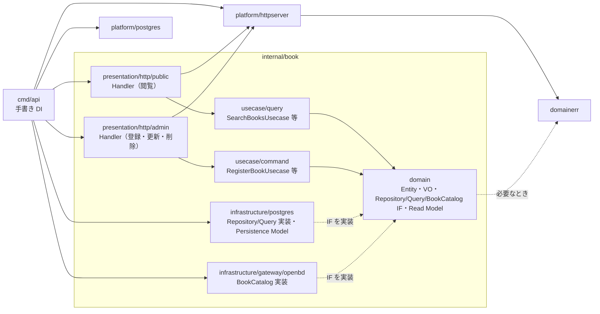

# バックエンド方針

## 文書の分担（MECE）

| 文書 | 管轄 |
|---|---|
| [`docs/architecture.md`](../docs/architecture.md) | リポジトリ全体・トップレベル構成・OpenAPI／FE との契約の境界 |
| **本書** | バックエンドのスタック・層・HTTP/OpenAPI・ディレクトリ・永続化 |
| [`frontend/architecture.md`](../frontend/architecture.md) | フロントのスタック・設計。OpenAPI **生成物の利用**のみ |

人が読む方針は **日本語**（AI 入口は `CLAUDE.md` / `.cursor/rules`）。

## 1. 決定（要約）

| 項目 | 決定 |
|---|---|
| 形 | **Go モノリス**（1 `go.mod`）。API バイナリは `cmd/api` の1つ |
| HTTP | **Echo** |
| 設計 | **オニオン** + DDD 戦術 + **CQRS**（単一 DB。全体 Event Sourcing はしない）。`internal/` の第一階層は**業務領域別**（`book` / `tag` / `auth`）、層は領域の中（§2） |
| 永続化 | **PostgreSQL + GORM**（現在状態が正）。**GORM AutoMigrate は使わない** |
| マイグレーション | **golang-migrate**（`backend/migrations/` が SQL の正。アプリ起動時 migrate しない） |
| HTTP / OpenAPI | Echo + validator + swag。**Go の DTO／Handler が BE の正** |
| FE 契約 | swag **排出 OpenAPI → TypeScript 生成は必須**（手編集禁止・CI ドリフト検知） |
| 書誌・書影 | 外部カタログ。Domain の `bookdomain.BookCatalog`（ExternalGateway）を `book/infrastructure/gateway/openbd` が実装する。画像は保存しない。openBD に書影が無ければ書影なし（[ADR](../docs/adr/2026-09-30-cover-from-openbd-only.md)） |
| 認証 | 書き込み系はログイン済みのセッション Cookie（`platform/httpserver.RequireAdminSession` + `RequireSameOrigin`）。閲覧は認証なし |
| ツールチェーン | **mise で Go 版を固定**（リポジトリ直下 `.mise.toml`。`go.mod` と揃える） |
| ローカル開発 | API は**ホストの Go**、DB は **Docker Compose**。Dev Container なし |
| 旧スタック | Kotlin / Spring Boot / jOOQ / Flyway と、旧仕様（書籍・著者の管理 API）の Go 版は**削除済み**（[ADR](../docs/adr/2026-09-28-rebuild-as-reading-portfolio.md)） |

マイクロサービス分割はしない。

### 1.1 ローカル開発

| 対象 | どう動かすか |
|---|---|
| Go 本体 | `mise install`（`.mise.toml` の `go`）→ ホストで `go run` / `make run` |
| PostgreSQL | `docker compose up -d`（`backend/docker-compose.yml`） |
| migrate | ホストの `golang-migrate`（`make migrate-up`）。アプリ起動時には走らせない |

Dev Container で IDE ごとコンテナに閉じ込める方式は採らない。

## 2. 層と依存

`internal/` の第一階層は **業務領域（area）別**（Package by Feature）。オニオンの各層は **領域の中** に置き、利用者による入口の差（誰でも見られる閲覧と、自分だけの管理）は **領域内の `presentation/http/<channel>`**（`public` / `admin`）で分ける。技術基盤は `platform/`、共通のエラー分類は `domainerr/` に置く。1 つの業務変更で触るファイルをできるだけ 1 つの領域ディレクトリにまとめ、領域の境界をディレクトリから読めるようにするため（領域をまたぐ連携は下の「領域間のルール」）。層別（`internal/<layer>/<area>/`）は 1 つの変更が層の数だけのディレクトリに散るため、チャネル別（`internal/<channel>/` + `shared`）は業務ルールがチャネルの数だけ複製されるか、持ち主の曖昧な共通コードが集まるため採らない。

```text
internal/
  <area>/                          # 業務領域（book・tag・auth）
    presentation/http/<channel>/   → usecase/{command,query}/ → domain/
    infrastructure/{postgres,gateway,bcrypt}/ ──（domain の IF を実装）──↗
  platform/{httpserver,postgres}/  # 技術基盤（業務ルールを持たない）
  domainerr/                       # ErrNotFound 等の分類と Violations（stdlib のみ）
```

**存在しない層は作らない**。例えば `auth` に閲覧（`public`）の入口は無く、`tag` に外部連携は無い。必要になった時点で足す。

### 領域内の依存関係（book）

import の向きと実行時の呼び出しの向きは別物: Infrastructure は Domain の IF を **実装** する（import は Infrastructure → Domain）。`cmd` は外側の組み立て役なので具象を知ってよい。



| 場所 | 責務 | 禁止事項 |
|---|---|---|
| `<area>/domain` | Entity／VO／業務の不変条件。**Repository IF**／**Query IF**／**ExternalGateway IF**（外部 API・SaaS 連携の抽象）と Read Model | Echo・GORM・SQL・DB 固有型・外部 SDK・HTTP Request／Response への依存 |
| `<area>/usecase/command` | 更新シナリオ。**業務上の認可**・Tx 境界・Command DTO → Domain Model の変換・相関ルール | HTTP DTO・ORM model の持ち込み、業務ルールの重複 |
| `<area>/usecase/query` | 参照シナリオ。Read Model の取得・整形 | 更新系 Domain Model の無理な流用 |
| `<area>/infrastructure/postgres` | Repository／Query の実装と Persistence Model（`gorm` タグ） | 業務ルールの実装、他領域から直接呼ばれる入口になること |
| `<area>/infrastructure/{gateway,bcrypt}` | ExternalGateway・パスワード照合など外部の技術の実装 | 同上 |
| `<area>/presentation/http/<channel>` | HTTP リクエスト／レスポンスの変換（Request／Response DTO・`BindValidate`・swag の注釈）と UseCase の呼び出し | **業務上の認可**・状態遷移・永続化 |
| `platform/httpserver` | Echo の初期化・`BindValidate`・`HTTPErrorHandler`・`ErrorResponse`・セッション／同一オリジンの middleware・graceful shutdown | 業務領域に固有のルール |
| `platform/postgres` | DB 接続・プール設定 | 同上 |
| `domainerr` | `ErrNotFound` / `ErrInvalid` / `ErrConflict` / `ErrUnauthorized` / `ErrTooManyAttempts` と `Violations`（stdlib のみ） | 業務ロジック・外部技術への依存 |

- Domain Service はエンティティに載せにくい業務ルール
- 命名目安: UseCase は IF `RegisterBookUsecase` + 公開の実装 `RegisterBookUsecaseImpl`、Handler は `Handler`（詳細は下の「配置と命名のルール」「型・メソッドの名前の付け方」）
- `cmd/api/main.go` で手書き DI（コンテナなし）: config → platform → infrastructure → usecase → presentation（`registerRoutes`）
- 外部 API・SaaS 呼び出しは UseCase から **ExternalGateway IF**（Domain 定義）経由で行う。Repository／Query と同じ理由（Domain が具体的な HTTP クライアント実装に依存しないため）で Domain に IF を置く

### 領域間のルール

- 他領域の `infrastructure`・Persistence Model を import して操作しない（実例: 本の登録が分野タグの存在を確かめるときは、`tag/domain` の Query IF を UseCase に注入する）
- 領域間の import 禁止は機械的に検査していない（レビューで確認する）。golangci-lint の `depguard` で強制するかは未決
- 複数領域にまたがる UseCase は、**どの領域が責任を持つか** を設計で決め、相手領域の公開された入口（Domain IF）を通じて連携する
- `platform` / `domainerr` に業務の持ち主が曖昧なコードを集めない。技術基盤と最小限のエラー分類に限る
- 業務ルールをチャネル別に複製しない（`internal/admin/domain` のような構成にしない）

### 配置と命名のルール（迷ったらここを写す）

- Go のパッケージ名はディレクトリ名と一致させる（`domain` / `query` / `command` / `postgres` / `public` / `admin` / `httpserver`）
- 領域のパッケージを import する側は `<area><役割>` の別名を付ける（同じ名前のパッケージが領域ごとにあるため）。実例（`cmd/api/main.go`）: `bookdomain`・`bookcmd`・`bookqry`・`pgbook`・`bookpublic`・`bookadmin`・`tagqry`・`tagadmin`・`authcmd`・`authbcrypt`、基盤は `pgplatform`（`httpserver`・`domainerr` は別名なし）
- **`Impl` は IF と実装が同じパッケージにあるときだけ付ける**（命名に迷わず全ドメインで同じ形にするため、条件を 1 つに決めておく）
  - UseCase: 同じパッケージに IF `XxxUsecase` と公開 struct `XxxUsecaseImpl` を置き、`cmd` で struct リテラル（`&bookcmd.RegisterBookUsecaseImpl{Books: ..., Catalog: ...}`）から組み立てる。Handler は IF にだけ依存するので、実装を変えても Handler は変わらない
  - Infrastructure: IF は Domain にあるので名前は衝突しない。非公開 struct（`repository` / `query`）+ Domain の IF を返す `NewRepository(db)` / `NewQuery(db)` で作り、`Impl` は付けない。呼び出し側は Domain の IF にしか依存できない
- ファイル名は小文字（区切りは `_`）。領域名や `_impl` を付けない（ディレクトリで分かる）。`_linux` / `_js` 等の OS・アーキテクチャ名で終わらせない（Go のビルド制約として解釈される）。テストは `_test.go` にし、テスト以外のファイルを `_test` で終わらせない。例: `register_book.go` / `register_book_test.go` / `query.go` / `repository.go`
- 会話・レビューでは同名を区別するためパッケージ名付きで呼ぶ（`bookdomain.Repository` = IF、`pgbook.NewRepository` = 実装、`bookcmd.RegisterBookUsecase` = UseCase）
- テストは対象と同じディレクトリに置く（[テスト規約](../docs/rules/testing.md)）
- **新しい業務領域の追加・境界の変更は設計レビューの対象**。要件と実際の変更理由から決め、予測で空パッケージを量産しない。ディレクトリは `internal/book` を写し、今必要な層だけ作る

### 型・メソッドの名前の付け方

名前は下の「設計原則」の目的駆動名前設計に従い、技術的な手段ではなく業務上の目的・振る舞いから付ける。用語は要件定義（[`docs/specifications.md`](../docs/specifications.md)）と同じ言葉を使う。

**UseCase**

- 型名は `<動詞><業務対象>Usecase`（綴りは `Usecase` のまま。`UseCase` にしない）。パッケージ名が `query` / `command` でドメインが呼び出し側から見えないため、型名に業務対象（`Book` / `Tag`）を入れる
- 単純な参照・更新・削除は `Read` / `Update` / `Delete`。登録・改名・ログイン・カタログの確認など業務上の意味を持つ操作は業務の動詞（`Register` / `Rename` / `Login` / `Logout` / `LookupCatalog`）にし、CRUD に寄せない
- `Read` は 1 件の参照だけに使う。一覧は、利用者が条件を指定するかどうかに関係なく `Search` にし、業務対象を複数形にする（`SearchBooksUsecase`）。`List` や `Get` は使わない（1 件と一覧が末尾の `s` だけで分かれて取り違えやすく、一覧の動詞を 1 つにして迷わないため）。複数形は複数件を返すことだけを表し、全件を返すとは限らない
- UseCase の名前を Repository／Query のメソッド名から決めない
- ファイル名は型名から `Usecase` を除いた snake_case（`search_books.go` / `rename_tag.go`）

| 業務の目的 | UseCase の型名 |
|---|---|
| 読んだ本を 1 件参照する | `ReadBookUsecase` |
| 読んだ本の一覧を参照する（検索・絞り込みを含む） | `SearchBooksUsecase` |
| 読んだ本を登録する | `RegisterBookUsecase` |
| 読んだ本を更新・削除する | `UpdateBookUsecase` / `DeleteBookUsecase` |
| 分野タグの名前を変える | `RenameTagUsecase` |
| 分野タグごとの冊数を数える | `CountBooksUsecase` |
| ログインする | `LoginUsecase` |

**Repository／Query のメソッド**

取得は `Find` を基本にし、目的が違うときだけ `Search` / `Count` / `Exists` を使う。同じ意味の取得に `Read` / `Get` / `Find` を混ぜない（UseCase の `Read` は業務の目的、Repository／Query の `Find` はデータの取得で、層の責務が違うため名前も違う）。更新系は `Create` / `Update` / `Delete`。

| 目的 | 名前 | 使う条件 |
|---|---|---|
| 一意なキーで 1 件 | `FindByID` | 条件が一意のときだけ。一意でない条件で 1 件を暗黙に選ばない |
| 全件 | `FindAll` | 全件を返す契約のときだけ |
| 固定の条件に合うものを全件 | `FindAllByTagID` | 一致したものを**すべて**返すときだけ。ページングした一部には使わない |
| 利用者が変えられる条件での検索 | `Search(criteria, range)` | キーワード・絞り込み・ページングなど。`WHERE` があるだけでは使わない |
| 件数 | `CountByTag` | 数値を返す |
| 存在するか | `ExistsAll` / `ExistsByISBN` / `ExistsByName` | `bool` を返す |

Query（読み取り側）は Read Model を返し、業務の状態を変えない。実例: `bookdomain.Query.Search`（条件・範囲付き）、`tagdomain.Query.FindAll`（全件）、`authdomain.SessionRepository.FindByID` / `Create`。

**Domain**

- Entity・集約・VO は業務の概念で名付け（`Book` / `Tag` / `ISBN` / `Review`）、`BookData` / `TagEntity` のような技術のサフィックスを付けない。種類が違うだけで Entity を機械的に分けない（業務の目的・不変条件・ライフサイクル・変更理由で判断する）
- メソッドは業務の振る舞いにする（`book.RefreshCatalog()` / `tag.Rename()`）。`UpdateStatus()` / `Process()` に業務の意味を隠さない。不変条件は状態を変えるメソッドの中で守る（事前に `Validate` を呼ばないと安全にならない形にしない）
- 判定は `bool` を返す `CanXxx`（操作できるか）/ `IsXxx`（状態）/ `HasXxx`（持っているか）。VO の生成条件は `NewXxx` がエラーを返して保証し、すべての型に `Validate` を付けない

### 層ごとの規則一覧（決まっていること）

層ごとに散らばっている規則の索引。正は各節（命名は上、HTTP は §3、テストは [テスト規約](../docs/rules/testing.md)、コメントは [コメントの書き方](../docs/rules/code-comments.md)）。「実例」は現在のコードにあるもの。

| 層 | 置き場・ファイル名 | 型・関数の命名 | テスト |
|---|---|---|---|
| **Domain** | `internal/<area>/domain/`。Entity と IF は `<area>.go`、VO は概念ごとのファイル（実例: `book/domain/{book,isbn,review,summary,title,list_range}.go`、`tag/domain/{tag,name}.go`、`auth/domain/{session,credentials}.go`）。エラーの分類は `internal/domainerr/{error,violation}.go` | 書き込み IF `Repository`・読み取り IF `Query`・外部連携 IF は業務の能力で名付ける（実例: `bookdomain.BookCatalog`、`authdomain.PasswordVerifier`）。Read Model は `XxxDetail` / `XxxList` / `XxxListItem` / `XxxSummary` など用途が分かる名前（実例: `BookDetail`、`TagListItem`）。VO の不変条件は `NewXxx` で保証 | DB・HTTP に依存しない。不変条件・業務ルール・境界値と、不正な状態を作れないこと |
| **UseCase（参照）** | `internal/<area>/usecase/query/`。1 UseCase 1 ファイル（実例: `book/usecase/query/{read_book,search_books,lookup_catalog}.go`、`tag/usecase/query/{search_tags,count_books}.go`） | IF `XxxUsecase` + 公開 struct `XxxUsecaseImpl`、メソッドは `Execute`、依存は公開フィールド（`Books bookdomain.Query`）。`cmd` で struct リテラルから組み立てる | 手書き Fake を注入し DB 無しで動かす。下位層のエラーが伝播すること |
| **UseCase（更新）** | `internal/<area>/usecase/command/`（実例: `book/usecase/command/{register_book,update_book,delete_book}.go`、`tag/usecase/command/{register_tag,rename_tag,delete_tag}.go`、`auth/usecase/command/{login,logout}.go`） | 参照と同じ。データを持つ入力は Command DTO `RegisterBookCommand` / `UpdateBookCommand`（UseCase の名前から `Usecase` を除き `Command` を付ける）、ID だけなら scalar 引数 | 参照と同じに加え、失敗時に状態が変わらないこと、入力エラー時に下位層が呼ばれないこと |
| **Infrastructure（DB）** | `internal/<area>/infrastructure/postgres/`。実装は `repository.go` / `query.go`、Persistence Model（`gorm` タグ）は同じファイルの非公開 `model`（実例: `book/infrastructure/postgres/{repository,query}.go`）。DB 接続は `internal/platform/postgres` | 非公開 struct（`repository` / `query`）+ Domain の IF を返す `NewRepository` / `NewQuery`。`Impl` は付けない。**型と各メソッドに日本語で概要の 1 行コメント** | 実際の PostgreSQL への契約テスト（繋がらなければ失敗）。SQL が複雑なもの（JOIN・集計・トランザクション）を優先し、Query は Read Model への詰め替えと書き込み側の型に依存しないことも確認 |
| **Infrastructure（外部連携）** | `internal/<area>/infrastructure/gateway/<提供元>/`（実例: `book/infrastructure/gateway/openbd/catalog.go`）。ハッシュ照合は `auth/infrastructure/bcrypt/bcrypt.go` | Domain の IF（`bookdomain.BookCatalog` 等）を実装。実装には提供元の名前を使ってよい | 偽の HTTP サーバ（`httptest`）に対する契約テスト |
| **Presentation** | `internal/<area>/presentation/http/<channel>/handler.go`（`public` = 閲覧、`admin` = 管理）。Request／Response DTO（`validate` タグ・swag コメント）も同じファイル（実例: `book/presentation/http/public/handler.go` の `Response` / `ListResponse`、`book/presentation/http/admin/handler.go` の `RegisterRequest`）。Echo・`BindValidate`・`HTTPErrorHandler`・セッション／同一オリジンの middleware は `internal/platform/httpserver` | struct `Handler`（同じチャネルに入口が 2 つあるときは `CatalogHandler` のように目的を付ける）、`Register(g *echo.Group)` でルート登録、メソッドは UseCase と同じ目的の名前。依存は公開フィールドで UseCase の IF。管理側が閲覧側と同じレスポンスを返すときは閲覧側の型（`bookpublic.Response`）を使う | `handler_test.go`（Fake の UseCase で 400 と domain error → ステータスの変換）と `handler_integration_test.go`（実 DB で、返しうるステータスごとに 1 件） |
| **cmd** | `cmd/api/main.go`（設定・DB 接続・起動・`registerRoutes`）、`sample_data.go`（見本データ） | import の別名は `<area><役割>`（上の「配置と命名のルール」） | `main_test.go`（in-package）で配線（依存の nil・middleware の適用）を実リクエストで検証 |
| **全層共通** | ファイル名は小文字・`_` 区切り。領域名・`_impl` を付けない | パッケージ名 = ディレクトリ名。会話ではパッケージ名付きで呼ぶ | 対象と同じディレクトリ。原則は外部テストパッケージ `<対象>_test`。入力違いはテーブルドリブン。DB・環境変数・グローバル状態を共有しないテストには `t.Parallel()` |

### 未決の規則（初めて作るときに決める）

まだ実例が無いか、現在のコードで書き方が揃っていないもの。該当する実装が初めて出る PR で決め、決めたら上の一覧と各節に反映する。推測で先に決めない。

| 対象 | 決めること |
|---|---|
| ID の型 | 今は `bookdomain.ID` / `tagdomain.ID` の型（`int64` の別名）。VO にするか |
| 領域間の import の検査 | 他領域の `infrastructure` を import しないことを golangci-lint の `depguard` で検査するか |
| Fake の置き場 | 各テストファイルに書くか、共有のテスト用パッケージを作るか（今は各ファイル） |
| テスト関数名 | `TestRepository_FindByID_NotFound` 形式（英語）と `TestXxx_日本語の振る舞い` の混在をどちらに揃えるか |
| DB を使うテストの並列実行 | 接続先・片付けは決定済み（[テスト規約](../docs/rules/testing.md)）。`t.Parallel()` を付けるか |

### 設計原則（目的駆動）

- **目的駆動名前設計**: 名前は「存在」ではなく「目的」で付ける。1 手段に対して目的は 1 つ
- **1 クラス 1 目的**: 目的が増えるほど変更の影響が広がる。目的ごとに分離する（例: 書籍の新規登録と更新で入力・検証が異なるなら `RegisterBookCommand` / `UpdateBookCommand` と UseCase を分ける）
- 共通化より「変更理由の分離」を優先する（似ているだけの処理を無理に1つへまとめない。「同じ理由で変更されるか？」で判断し、`Common` / `Util` / `Manager` / `Helper` / `BaseService` のような曖昧な共通クラスを安易に作らない）
- **Domain は外部技術に依存しない**（§2 表の「他層に依存しない」の具体化）: Web Framework（Echo）／Controller／Request・Response／ORM（GORM）／SQL／DB 固有型／外部 API SDK／Infrastructure 実装のいずれも Domain から直接参照しない。外部との通信が要るときは Repository／Query／ExternalGateway の Interface を経由する
- **業務ルールは Domain（VO・Entity）に閉じ込め、不正な状態を生成できない設計を優先する**: 呼び出し側の複数箇所に同じ範囲チェックを書く（例: `if price >= 0 && price <= 99999999` があちこちに存在する）のではなく、VO のコンストラクタ1箇所で不変条件を保証する（例: 書籍価格 VO のコンストラクタが 0 以上を保証する）
- **モデルは目的ごとに区別し、構造を無理に一致させない**: 同じ「書籍」でも
  - **Domain Model**（業務ルールを表現。例: `book/domain.Book` + `Rating` VO）
  - **Read Model**（参照専用に最適化。例: `book/domain.BookListItem`。命名は `XxxView` / `XxxReadModel` / `XxxListItem` / `XxxSummary` など用途が伝わるものでよい）
  - **Persistence Model**（DB 永続化専用。例: `book/infrastructure/postgres.model`、`gorm` タグ付き）
  はそれぞれ別目的であり、DB テーブル構造をそのまま Domain Model として扱ってはならない

変更容易性 = 影響範囲が局所化され、関係ない機能が壊れにくい状態

### CQRS（Repository と Query）

| | 書き込み側 | 読み取り側 |
|---|---|---|
| Domain IF | `<area>/domain.Repository` | `<area>/domain.Query` |
| UseCase | `<area>/usecase/command` | `<area>/usecase/query` |
| Infrastructure | `<area>/infrastructure/postgres.NewRepository` | `<area>/infrastructure/postgres.NewQuery` |

- 同一テーブルを両方から触ってよい（実装を1 struct にまとめて両方の IF を満たしてもよい）
- DB は1つ（アプリでの Writer/Reader 必須分離はしない）
- イベント／投影は必要なドメインだけ。分散イベントバス・全体 ES はしない
- 複数テーブルにまたがる更新など厳密整合は同一トランザクションの Command
- **更新系**: 境界は **Command DTO**（`<area>/usecase/command` が定義。例: `RegisterBookCommand` / `UpdateBookCommand`）で受け渡す。UseCase 内で DTO → ドメインモデル（Entity/Aggregate）へ変換してから Repository に渡す
  - Presentation の Request 構造体・ORM Entity・DB Entity・Framework 依存オブジェクト（`echo.Context` 等）を UseCase／Domain へ直接渡さない。Handler は Request から値を取り出して Command DTO を組み立てる
  - Command DTO 自身に業務ロジック（バリデーション・状態遷移・DB／外部 API アクセス）を書かない。責務はデータの受け渡しのみで、判定は Domain（VO のコンストラクタ等）に置く
- **参照系**: **Read Model**（参照専用モデル）中心で設計する。表示・検索用途に最適化した形を返し、更新系 DTO やドメインモデルを無理に再利用しない
- 更新モデルと参照モデルを混在させない（同じ struct を両方の用途に使い回さない）

### Query / ExternalGateway の IF 置き場

Repository／Query／ExternalGateway の IF はすべて **Domain** に置き、実装だけを Infrastructure に置く（UseCase には置かない）。種類によって置き場を変えると「なぜ IF によって置き場が違うのか」を調べ直すコストが生じるため、外部リソースへの抽象 IF は常に Domain に置くことで一貫させる。

### Command DTO を使う範囲

作成・更新するデータを受け取る UseCase は、フィールドが1つでも Command DTO を使う。ID のみを受け取る操作（Delete 等）は scalar 引数のままでよい（1 フィールドの入れ物は何の契約も表現しないため）。

## 3. HTTP / OpenAPI

**BE の正**: Go のリクエスト／レスポンス DTO（`validate` タグ）と薄い Handler（swag コメント付き）

| 要素 | 内容 |
|---|---|
| 入力 | 共通 `BindValidate[T]`（`Bind` + `validate.Struct`）。失敗時は 400 + フィールド単位 `errors[{field, rule}]`（`field` は JSON 名）。Domain VO・UseCase（相関ルール）の違反も `domainerr.Violations` として同じ 400 の `errors` に集約し、独立して判定できる違反をすべて返す（[`docs/architecture.md`](../docs/architecture.md) §4「バリデーションの全件返却」） |
| 相関ルール | Handler の swag 拡張 `@x-correlation-rules`（JSON 配列 `[{"id","field","rule","message"}]`）が詳細設計。`swagger.yaml` の operation に `x-correlation-rules` として出る。実装は UseCase、`id` が `errors[].rule` になる |
| Handler | path パース → BindValidate（必要時）→ **UseCase** → JSON。エラーは `return err` するだけ |
| エラー | Echo の `HTTPErrorHandler` に1か所で登録（domain error → 4xx/5xx）。各 Handler に分岐を散らさない。5xx は error ログ＋メッセージ秘匿、4xx は warn ログ |
| OpenAPI | **swag で排出**（`backend/api/docs/` 等。手編集しない） |
| FE | 排出 OpenAPI → **openapi-typescript または orval**（必須） |
| 共通エラー形 | `ErrorResponse` を DTO で1か所 |
| ログ | `slog` のテキスト形式（デプロイしないので環境ごとに切り替えない）。アクセスログは RequestID 付き |
| 終了 | SIGINT / SIGTERM で graceful shutdown |

```text
Go DTO + validate + 薄い Handler + swag
  → swag init（OpenAPI 排出）
  → TypeScript 生成（必須）
  → FE は生成物のみ
  → CI: 排出 + TS gen → git diff --exit-code
```

### やらないこと（HTTP）

- ルート手書き `openapi/` を正とし **oapi-codegen で Server IF を生成**する方式（OpenAPI Design First）。契約を先に合意できる利点はあるが、全 Handler の書き換えになるため**保留**（[ADR](../docs/adr/2026-11-02-revise-development-rules.md)）
- **Huma**
- 各 Handler に Bind / validate / ステータス分岐を冗長コピペする方式
- FE で API 型を手書きして正とする運用
- TS／swag 排出物の手編集

### 漏れにくくする

- 文字数など業務制約は **domain VO** でも保証（HTTP タグだけに頼らない）
- HTTP ステータスは `HTTPErrorHandler` に集約

## 4. ディレクトリ（目安）

```
backend/
  cmd/
    api/main.go
  config/
  api/docs/                 # swag 排出 OpenAPI（手編集しない）
  migrations/               # golang-migrate
  internal/
    book/                         # 業務領域: 読んだ本
      domain/                     # Entity・VO・Repository/Query/BookCatalog IF・Read Model・ListRange
      usecase/{command,query}/
      infrastructure/
        postgres/                 # Repository/Query 実装・Persistence Model
        gateway/openbd/           # BookCatalog の実装（外部カタログ）
      presentation/http/
        public/                   # GET /api/books・/api/books/{id}
        admin/                    # POST・PUT・DELETE /api/books、GET /api/catalog/{isbn}
    tag/                          # 業務領域: 分野タグ（gateway は無い）
      domain/ usecase/{command,query}/ infrastructure/postgres/
      presentation/http/{public,admin}/
    auth/                         # 業務領域: 管理画面のログイン（閲覧の入口は無い）
      domain/ usecase/{command,query}/
      infrastructure/{postgres,bcrypt}/
      presentation/http/admin/
    platform/
      httpserver/                 # Echo・BindValidate・HTTPErrorHandler・ErrorResponse・認証 middleware・Serve
      postgres/                   # DB 接続・プール設定
    domainerr/                    # ErrNotFound 等の分類と Violations
  docker-compose.yml
  Makefile
  go.mod
  README.md
```

業務領域の追加は、境界が明確になってから（空の量産はしない）。

### プロダクト API 範囲

| Method | Path | 用途 | 認証 |
|---|---|---|---|
| `GET` | `/api/books` | 読んだ本の一覧（新しく登録した順。`limit` 1〜100・既定20、`offset`。`q`（書名・著者の部分一致）と `tagId`（分野タグ）で絞り込める。総件数は条件に合う件数。感想の本文は含めない） | 不要 |
| `GET` | `/api/books/{id}` | 読んだ本の詳細（書誌・書影・Amazon リンク・感想・評価） | 不要 |
| `POST` | `/api/books` | 読んだ本を登録する（`isbn`・`summary`・`comment`・`rating`、任意で `titleOverride`・分野タグ（`tagIds`）。書誌と書影は ISBN で外部カタログから取得。openBD に無ければ 400（`isbnNotInCatalog`）、同じ ISBN は 400（`isbnDuplicated`）、存在しないタグは 400（`tagIdsNotFound`）） | 必要 |
| `PUT` | `/api/books/{id}` | 一言まとめ・感想・評価・書名の上書き・分野タグ（`tagIds`）を更新する（楽観的ロック（409）。存在しないタグは 400（`tagIdsNotFound`）。書誌と書影を取り直す） | 必要 |
| `DELETE` | `/api/books/{id}` | 読んだ本を削除する | 必要 |
| `GET` | `/api/catalog/{isbn}` | 登録前に、ISBN で外部カタログの書誌と書影を確かめる | 必要 |
| `GET` | `/api/tags` | 分野タグの一覧 | 不要 |
| `GET` | `/api/tags/counts` | 分野タグごとの冊数（本が付いていないタグは含めない。冊数の多い順、同数ならタグ名順） | 不要 |
| `POST` | `/api/tags` | 分野タグを追加する（同名は 400（`tagNameDuplicated`）） | 必要 |
| `PUT` | `/api/tags/{id}` | 分野タグの名前を変更する（楽観的ロック（409）。同名は 400（`tagNameDuplicated`）） | 必要 |
| `DELETE` | `/api/tags/{id}` | 分野タグを削除する（付いていた本からは自動で外れる） | 必要 |
| `POST` | `/api/auth/login` | ID とパスワードでログインし、セッション Cookie を発行する（失敗が続くと一時的に拒否） | 不要 |
| `POST` | `/api/auth/logout` | セッションを破棄して Cookie を消す | 不要 |
| `GET` | `/api/auth/session` | ログイン済みか確かめる（未ログインは 401） | 必要 |

- 認証は httpOnly Cookie `admin_session`。ID とパスワードのハッシュは環境変数（`ADMIN_ID` / `ADMIN_PASSWORD_HASH`）。自分だけが書き込めればよいので、ユーザー管理は持たない
- 書影は提供元の URL をそのまま返す（[ADR](../docs/adr/2026-09-28-book-cover-from-external-catalogs.md)）。登録と更新のたびに取り直す

## 5. やらないこと（全体）

- 全体 Event Sourcing / イベントストア正
- Command 用 DB と Query 用 DB の分離
- 分散イベントバス初期前提
- マルチサービス分割
- Dev Container

## 6. コマンド

日常の品質チェックは `make fmt-check lint vuln test`（CI と同じ。一覧は `make help`）。

### OpenAPI 排出

```bash
make tools          # swag / migrate / golangci-lint / govulncheck を版固定で導入
make swagger        # 排出
make swagger-check  # ドリフト検査（CI と同じ）
```

排出物は `api/docs/swagger.yaml` / `swagger.json`（手編集しない。`.gitattributes` の `linguist-generated` で PR の差分では折りたたまれる）。FE はこれを入力に TypeScript を生成する。
