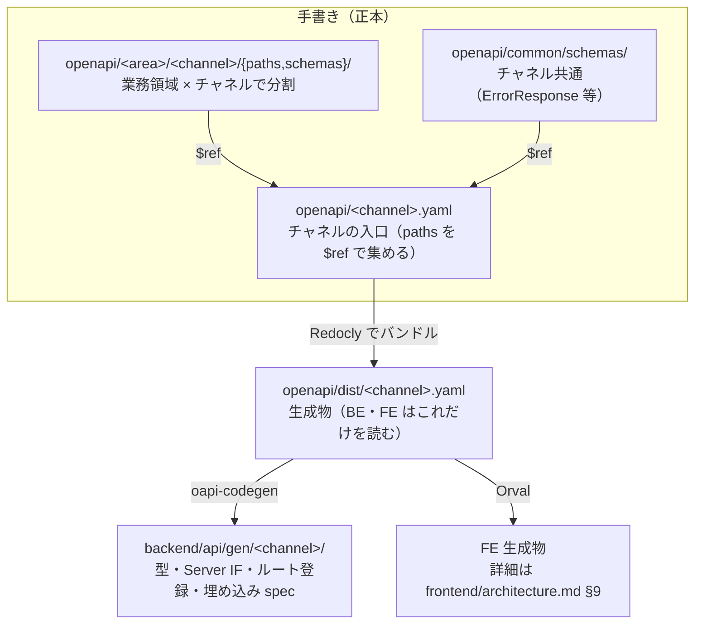

# アーキテクチャ方針

自分が読んだ本を紹介するポートフォリオ。誰でも見られる紹介画面（public）と、自分だけが使う登録・編集画面（admin）を同一リポジトリで扱う。読んだ本は ISBN で登録し、書誌と書影は外部カタログ（openBD）から取得して、自分の感想と評価を添える。本と分野タグの真実は 1 つで、admin で登録・更新したものがそのまま public に出る。

デプロイはしない（要求の範囲外）。ローカルで動かして見せる。

## 文書の言語

| 種類 | 言語 |
|---|---|
| 人が読む方針（本書・`docs/**`・パッケージ README など） | **日本語** |
| AI 入口（`CLAUDE.md`・`AGENTS.md`） | **英語**（長い方針はここに複製せず、日本語の正を参照） |

| 文書 | 管轄（重複しない） |
|---|---|
| [`README.md`](../README.md) | 人が読む資料の入口（読む順番と各資料の役割）・リポジトリ全体のディレクトリ構成。規則は書かない |
| **本書** | リポジトリ全体の方針・チャネル／契約の**境界**・API 契約（`openapi/`）の配置と規則 |
| [`backend/architecture.md`](../backend/architecture.md) | バックエンドのスタック・層・HTTP（OpenAPI からの BE 生成）・ディレクトリ・永続化 |
| [`frontend/architecture.md`](../frontend/architecture.md) | フロントのスタック・設計パターン・アプリ内ディレクトリ・共有ルール |
| [`requirements/`](requirements/) | 要件（機能群・進み具合・論点の扱い） |
| [`rules/`](rules/) | 開発の規則（開発の流れ・Git・テスト・コメント・DB 資料・入力文字・管理画面のデザイン） |

フロントの実装詳細は本書に書かない。バックエンド実装詳細は [`backend/architecture.md`](../backend/architecture.md) に書き、本書は境界のみ。

## 1. 決定（要約）

| 項目 | 決定 |
|---|---|
| バックエンド | **Go / Echo モノリス**（1 `go.mod`）。`internal/` の第一階層は**業務領域別**（`internal/book/`・`tag/`・`auth/`）で、Presentation → UseCase → Domain ← Infrastructure の層は各領域の中に置く。技術基盤は `internal/platform/`。CQRS で Repository／Query 分離（単一 DB）。実行サービスはチャネルごとに 2 つ（`public-api` / `admin-api`）。正は [`backend/architecture.md`](../backend/architecture.md) |
| フロントエンド | **public / admin**（Web）の 2 アプリ。正は [`frontend/architecture.md`](../frontend/architecture.md)。**mise + pnpm**（Docker / Dev Container は使わない） |
| API 契約（境界） | **OpenAPI Design First**。リポジトリ直下 `openapi/` の手書き YAML が正。BE（oapi-codegen）と FE（Orval）は**どちらもそこから生成**する。生成物は手編集しない。CI で lint・破壊的変更・生成ドリフトを検知。詳細は §4 |
| モジュラモノリス / マイクロサービス | **採用しない**（境界が必要になったら後からパッケージを育てる） |
| 端末前提（画面・API） | **public = スマホ主**（PC でも致命的な崩れなし）。**admin = PC のみ**。詳細は frontend 文書 |
| ツールの版 | **mise**（`.mise.toml`）で Go・Node・pnpm を固定する。版は原則として公開から 2 週間以上たったものを選ぶ（セキュリティ修正版は例外として早めに取り込む） |

## 2. バックエンド（境界のみ）

正は [`backend/architecture.md`](../backend/architecture.md)。

本書が持つのは次だけ:

- 本と分野タグの真実は1つ。チャネルで API/DB を割らない
- チャネル差は path・認可・入力粒度（`/api/...` は public、`/api/admin/...` は admin）
- パッケージは**業務領域が第一階層**。チャネル別の Handler は各領域の `presentation/http/<channel>` に置き、Domain・UseCase はチャネルで複製しない（業務上の認可は UseCase）
- 実行サービスは業務ロジックを共有したまま閲覧（`cmd/public-api`）と管理（`cmd/admin-api`）で分ける
- ローカル開発: **ホスト Go（mise で版固定）+ Docker は DB**。API の日常起動はコンテナにしない（詳細は backend 文書）

## 3. フロントエンド（境界のみ）

正は [`frontend/architecture.md`](../frontend/architecture.md)。

本書が持つのはモノレポ境界だけ:

- アプリ分割（Web）: `frontend/public` / `frontend/admin`
- チャネル横断コード（Web）: `frontend/packages/`（中身の規約は frontend 文書）
- path 例（API）: `/api/books`（public）、`/api/admin/books`（admin）

## 4. OpenAPI / 型契約（境界）

API 契約の正本は **`openapi/` の手書き YAML**（OpenAPI 3.0.3）。BE・FE はそこから HTTP 境界のコードを生成し、業務ロジックは生成しない。

採用理由: 仕様と実装のずれを CI とコンパイルで検知でき、`required`・`enum` を契約に書けて FE が手で補わずに済み、実装より先に契約を合意できるため。Go のコメントから仕様を排出する Code First（swag）は、コメントとルート登録のずれを検知できないため廃止した（旧運用では生成物に `required`・`nullable`・Cookie の認証が出ず、FE が手で補っていた）。3.1 ではなく 3.0.3 にしたのは、ツール間の互換性が安定しているため（3.1 の機能が必要になったら見直す）。

| 側 | 生成するもの | 手書きするもの | 詳細 |
|---|---|---|---|
| Backend | Request／Response 型、パラメータ型、Server IF、Echo のルート登録、埋め込み spec（入力検証に使う） | Handler 本体、型変換、UseCase・Domain・Infrastructure、業務の検証・認可 | [`backend/architecture.md`](../backend/architecture.md) §3 |
| Frontend | API 型、Client、TanStack Query hook、MSW・faker、フォームの入力チェック用の zod スキーマ | 画面・Component、UI 状態、API エラーの表示 | [`frontend/architecture.md`](../frontend/architecture.md) §9 |

- **チャネル（実行サービス）ごとに 1 つの入口とバンドル**（`public` / `admin`）。正本は業務領域 × チャネルで分け、生成は実行サービス単位にまとめる（全チャネルを 1 つの生成物にすると、public のサーバーが admin の IF まで実装を迫られるため）。チャネル同士で operation を共有しない（admin の画面が使う本の参照・一覧・タグの一覧も admin チャネルに持つ）
- OpenAPI 関連のツール（Redocly・oapi-codegen・oasdiff・kin-openapi・Orval）の版は、原則として公開から 2 週間以上たったものを選び、固定する（セキュリティ修正版は例外）。固定先は Redocly・oasdiff が `openapi/Makefile`、oapi-codegen が `backend/Makefile`、kin-openapi が `backend/go.mod`、Orval が各アプリの `package.json` と `pnpm-lock.yaml`
- `operationId` は必須で、その operation が呼ぶ BE の UseCase の型名から `Usecase` を除いた lowerCamel にする（`SearchBooksUsecase` → `searchBooks`、`ReadBookUsecase` → `readBook`）。動詞は UseCase の命名規則（1 件の参照は `Read`・一覧は `Search` / `Create` / `Update` / `Delete`、業務の意味を持つ操作は業務の動詞。[`backend/architecture.md`](../backend/architecture.md) §2）に従う。チャネル内で一意。BE の Handler のメソッド名・FE の hook 名になる（operation は UseCase を 1 つ呼ぶためにあり目的が同じなので、Handler・UseCase・FE の hook を同じ名前で追えるようにする）。`summary` は operationId と同じ動詞で始める（`searchBooks` → `Search books`、`readBook` → `Read a book`。summary は生成物のコメントや API の文書に出るので、動詞が違うと別の操作に見えるため）。1 つの operation は UseCase を 1 つだけ呼ぶ。複数の UseCase をまとめる必要があれば、まとめた目的で 1 つの UseCase にする。1 つの UseCase を複数の operation から呼ぶ必要が出たら（チャネル違いは除く）、この規則を見直す（名前の対応は下の「名前を揃えるもの・揃えないもの」）
- スキーマ名はチャネル内で一意（バンドル時に `components/schemas` の名前になる）
- 実際に返すステータスだけを書く。必須のフィールドは `required` を書く
- **エラーのレスポンス（`ErrorResponse`）は画面に出す文言を返さない**。`message` は開発者・ログ向けにする。代わりに、FE が文言を引くためのコードを返す。入力検証と相関ルールの違反は 400 の `errors[{field, rule}]`（`rule` は OpenAPI の制約キーワードか、`x-correlation-rules` の `id`）、業務ルールの違反（対象が存在しない・版の競合・ログインの失敗など）は `code`（operation の拡張フィールド `x-error-codes` に列挙する）。5xx はコードを返さない。文言に差し込む値（ログインを再び受け付けるまでの秒数など、BE しか知らない値）は `params`（キーと値の組。`ErrorResponse` と `errors[]` の各要素に任意で付ける）で返す。値は加工しない形（数値、日時は ISO 8601）で返し、表示の形は FE が整える（表示の形を BE と FE の 2 か所で持たないため）。OpenAPI に書いた固定の制約の値（`maxLength` など）は FE も知っているので返さない（文言を BE で持つと、同じ制約の文言が FE の zod による検証と BE で二重になり、入力欄の近くに出すにも FE が `field` を知る必要があるため）
- `enum` は**値の集合が DB の制約か Domain（VO 等）で保証されている項目だけ**に書く。慣習で値が決まっているだけの項目は文字列にし、現在の値は `description` に書く（保証の無い enum は、範囲外の値が入ったときに契約違反のレスポンスになる）
- **生成物（`openapi/dist/`・BE・FE）は手編集しない**。FE で API 型を手書きして正としない
- 仕様変更は「YAML 変更 → バンドル → BE・FE を再生成」を同じ流れで行う。コマンドは backend / frontend 文書

### バリデーションの全件返却

- 入力検証・相関バリデーションの違反は HTTP 400 の `errors[{field, rule}]` に、独立して判定できるものをすべて返す。順序は保証せず、FE も順序に依存しない。同一の `field`・`rule` は重複させない。
- 重複登録は相関バリデーションに含める。同じ ISBN（`isbnDuplicated`）と存在しない分野タグ（`tagIdsNotFound`）が同時にあれば、両方返す。先に見つけた1件で打ち切らない。
- `field` は必須。対応する入力欄がない相関ルールは空文字 `''`（画面全体）とする。FE はその `rule` に定義された表示先を使う。
- JSON を解析できない場合や認証・認可失敗、対象なし、version 不一致、システム障害は全件収集の対象外。型・必須違反などで前提が成立しないチェックは実行しない（ISBN の形が不正なら重複・外部カタログの検査はしない）。無関係な項目の検証は継続する。HTTP 境界の違反があると UseCase には進まない。不正な値を Domain の値オブジェクトへ無理に変換しない。外部カタログ（openBD）への照会は、ほかの違反が 1 つも無いときだけ行う（外部 API を無駄に呼ばないため）。
- 400 がある場合は保存しない。DB に依存する相関検証も保存と同じ UseCase の中で行う。事前の重複チェックだけで整合性を保証せず、一意制約等も維持する（同時の登録・改名で一意制約に当たった場合は 409 で返す）。
- 409 は version 等の楽観ロックによる競合（`versionConflict`）と、同時の操作で一意制約に当たったときに使い、事前に判定できる重複登録には使わない。採用理由: 重複を 409 にすると楽観ロックの競合と区別できず、FE が同じ 409 を 2 つの意味で扱うことになるため。
- 全件返却の受け入れ条件は、複数項目の入力違反、入力違反と独立した相関違反の併発、ISBN の重複と存在しない分野タグの併発、判定前提が欠けるケースを含む。配列は順不同で比較する。

### 名前を揃えるもの・揃えないもの

目的が同じものだけ名前を揃える。FE の画面・独自の hook は目的が違うので、operationId や UseCase に揃えない。

| もの | 目的 | 名前 |
|---|---|---|
| FE の画面・独自の hook | 画面で何を見せ、何をさせるか（例: 本の一覧を検索欄付きで見せる） | 画面の目的で付ける（`BooksListPage`・`useBooksList` など。[`frontend/architecture.md`](../frontend/architecture.md) §17） |
| FE の生成 hook・関数 | その API の操作を呼ぶ | operationId のまま（`useSearchBooks`） |
| operationId（BE の Handler のメソッド） | API の操作 | UseCase と同じ（1 対 1。`searchBooks` / `SearchBooks`） |
| BE の UseCase | 業務の目的（例: 本を条件で探す） | `SearchBooksUsecase`（[`backend/architecture.md`](../backend/architecture.md) §2） |

### CI（必須）

| 検査 | 内容 |
|---|---|
| lint | Redocly（`openapi/redocly.yaml`）。構文・スキーマ・operationId の一意性 |
| バンドル差分 | バンドルを再実行 → `git diff --exit-code` |
| 破壊的変更 | oasdiff で PR のベースと比較。**警告のみ**（公開して利用者がいる API ではないため。外部に公開したら fail にする） |
| 生成差分 | BE（oapi-codegen）・FE（Orval）を再実行 → `git diff --exit-code` |
| 実装との整合 | `cmd` があるチャネルは、生成 IF を実装しないとコンパイルが通らない（詳細設計の PR では未実装の operation にスタブを置く。[`docs/rules/development-flow.md`](./rules/development-flow.md) §3）。レスポンスの形は BE のテストで spec に対して検証する |

## 5. リポジトリ構成

ディレクトリ構成の正はリポジトリ直下の [`README.md`](../README.md)「ディレクトリ構成」。
