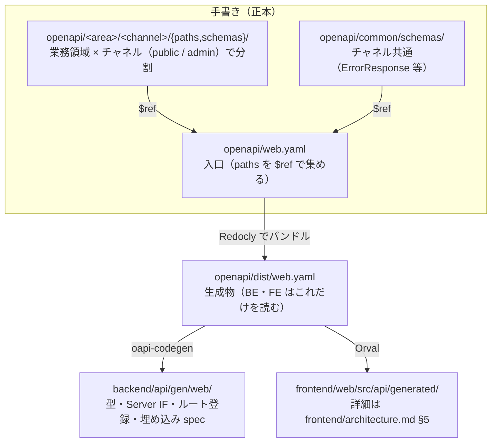

# アーキテクチャ方針

自分が読んだ本を紹介するポートフォリオ。バックエンド API（Go）と Web 画面（React）を同一リポジトリで扱う。読んだ本は ISBN で登録し、書誌と書影は外部カタログ（openBD）から取得して、自分の感想と評価を添える。閲覧は誰でも、登録・更新・削除は自分だけができる。

## 文書の言語

| 種類 | 言語 |
|---|---|
| 人が読む方針（本書・`docs/**`・パッケージ README など） | **日本語** |
| AI 入口（`CLAUDE.md`・`.cursor/rules/*.mdc`） | **英語**（長い方針はここに複製せず、日本語の正を参照） |

| 文書 | 管轄（重複しない） |
|---|---|
| [`README.md`](../README.md) | 人が読む資料の入口（読む順番と各資料の役割）・リポジトリ全体のディレクトリ構成。規則は書かない |
| [`requirements.md`](./requirements.md) | 要求定義（誰に何を伝えるために作るか） |
| [`specifications.md`](./specifications.md) | 要件定義（システムと開発の進め方が満たすこと） |
| **本書** | リポジトリ全体の方針・チャネル／契約の**境界**・API 契約（`openapi/`）の配置と規則 |
| [`backend/architecture.md`](../backend/architecture.md) | バックエンドのスタック・層・HTTP（OpenAPI からの BE 生成）・ディレクトリ・永続化 |
| [`frontend/architecture.md`](../frontend/architecture.md) | フロントのスタック・設計パターン・アプリ内ディレクトリ・共有ルール |
| [`rules/`](./rules/) | 開発の規則（開発の流れ・Git・テスト・コメント・ADR・DB 資料） |

フロントの実装詳細は本書に書かない。バックエンド実装詳細は [`backend/architecture.md`](../backend/architecture.md) に書き、本書は境界のみ。

## 1. 決定（要約）

| 項目 | 決定 |
|---|---|
| バックエンド | **Go / Echo モノリス**（1 `go.mod`・API バイナリ1つ）。`internal/` の第一階層は**業務領域別**（`book` / `tag` / `auth`）で、Presentation → UseCase → Domain ← Infrastructure の層は各領域の中に置く。技術基盤は `internal/platform/`。CQRS で Repository／Query 分離（単一 DB）。正は [`backend/architecture.md`](../backend/architecture.md) |
| フロントエンド | **React + Vite + TypeScript** の管理画面 `frontend/web`。**mise + pnpm**。正は [`frontend/architecture.md`](../frontend/architecture.md) |
| API 契約（境界） | **OpenAPI Design First**。リポジトリ直下 `openapi/` の手書き YAML が正。BE（oapi-codegen）と FE（Orval）は**どちらもそこから生成**する。生成物は手編集しない。CI で lint・破壊的変更・生成ドリフトを検知。詳細は §4 |
| モジュラモノリス / マイクロサービス | **採用しない**（境界が必要になったら後からパッケージを育てる） |
| 旧実装 | Kotlin / Spring Boot 版、および旧仕様（書籍・著者の管理 API）の Go 版は削除済み（[ADR](./adr/2026-09-28-rebuild-as-reading-portfolio.md)） |

## 2. バックエンド（境界のみ）

正は [`backend/architecture.md`](../backend/architecture.md)。

本書が持つのは次だけ:

- データ（読んだ本・分野タグ）の真実は 1 つ。利用者（誰でも見られる閲覧と、自分だけの管理）で API・DB を割らない
- 利用者の差は **チャネル**（`public` = 閲覧、`admin` = 管理）として、各業務領域の `presentation/http/<channel>` に置く。Domain・UseCase はチャネルで複製しない（業務上の認可は UseCase）
- チャネル差は path: 閲覧は `/api/...`（例: `/api/books`）で認証なし、管理は `/api/admin/...`（例: `/api/admin/books`）でログイン済みのセッション Cookie
- ローカル開発: **ホスト Go（mise で版固定）+ Docker は DB**。API の日常起動はコンテナにしない（詳細は backend 文書）

## 3. フロントエンド（境界のみ）

正は [`frontend/architecture.md`](../frontend/architecture.md)。

- アプリ: `frontend/web`（読んだ本の紹介画面と、自分用の登録・編集画面）
- アプリ横断コード: `frontend/packages/`（中身の規約は frontend 文書）

## 4. OpenAPI / 型契約（境界）

API 契約の正本は **`openapi/` の手書き YAML**（OpenAPI 3.0.3）。BE・FE はそこから HTTP 境界のコードを生成し、業務ロジックは生成しない。

採用理由: 仕様と実装のずれを CI とコンパイルで検知でき、`required`・`enum`・入力の制約を契約に書けて FE が手で補わずに済み、実装より先に契約を合意できるため。Go のコメントから仕様を排出する Code First（swag）は、コメントとルート登録のずれを検知できず、Swagger 2.0 では `required`・`nullable`・Cookie の認証を書き切れないため廃止した。Go のコードから 3.1 を排出する Huma も、Code First のままで実装より先に契約を合意する場所にならないため採らない。3.1 ではなく 3.0.3 にしたのは、ツール間の互換性が安定しているため（3.1 の機能が必要になったら見直す）。

管理の API を `/api/admin` 配下に分けた理由: パスで認証の範囲が読め、セッション Cookie の Path を `/api/admin` に絞って閲覧の要求に送らずに済み、same-origin の検査もパスで掛けられるため（`security` だけで区別するとこれらができない）。閲覧と管理でバンドルを分けないのは、同じサーバー（`cmd/api`）が両方を受け、生成とルート登録は 1 つで足りるため。3.1 ではなく 3.0.3 にしたのは、ツール間の互換性が安定しているため（3.1 の機能が必要になったら見直す）。



| 側 | 生成するもの | 手書きするもの | 詳細 |
|---|---|---|---|
| Backend | Request／Response 型、パラメータ型、Server IF、Echo のルート登録、埋め込み spec（入力検証に使う） | Handler 本体、型変換、UseCase・Domain・Infrastructure、業務の検証・認可 | [`backend/architecture.md`](../backend/architecture.md) §3 |
| Frontend | API 型、Client、TanStack Query hook、MSW・faker、フォームの入力チェック用の zod スキーマ | 画面・Component、UI 状態、API エラーの表示 | [`frontend/architecture.md`](../frontend/architecture.md) §5 |

- **実行サービス（`cmd/api`）ごとに 1 つの入口とバンドル**（`web`）。正本は業務領域 × チャネルで分け、生成は実行サービス単位にまとめる。閲覧（`public`）と管理（`admin`）は同じサーバーが受けるので 1 つのバンドルにする（別のサーバーに分けるときは入口を分ける）
- 管理の API は `/api/admin` 配下に置き、`security` に `adminSession`（セッション Cookie）を書く（ログイン・ログアウトは `security: []`）。サーバーは spec の `security` とパスから認証の middleware を掛けるので、operation を足すときは YAML に書けば認証が付く
- OpenAPI 関連のツール（Redocly・oapi-codegen・oasdiff・kin-openapi・Orval）の版は、原則として公開から 2 週間以上たったものを選び、固定する（セキュリティ修正版は例外）。固定先は Redocly・oasdiff が `openapi/Makefile`、oapi-codegen が `backend/Makefile`、kin-openapi が `backend/go.mod`、Orval が `frontend/web/package.json` と `pnpm-lock.yaml`
- `operationId` は必須で、その operation が呼ぶ BE の UseCase の型名から `Usecase` を除いた lowerCamel にする（`SearchBooksUsecase` → `searchBooks`、`ReadBookUsecase` → `readBook`）。動詞は UseCase の命名規則（1 件の参照は `read`・一覧は `search`・業務の意味を持つ操作は業務の動詞（`register` / `rename` / `login`）。[`backend/architecture.md`](../backend/architecture.md) §2）に従う。一意。BE の Handler のメソッド名・FE の hook 名になる（operation は UseCase を 1 つ呼ぶためにあり目的が同じなので、Handler・UseCase・FE の hook を同じ名前で追えるようにする）。`summary` は operationId と同じ動詞で始める（`searchBooks` → `Search books`、`readBook` → `Read a book`）。1 つの operation は UseCase を 1 つだけ呼ぶ
- スキーマ名は一意（バンドル時に `components/schemas` の名前になる）
- 実際に返すステータスだけを書く。必須のフィールドは `required` を書く。必須の文字列が空で困る項目は `minLength: 1` も書く（`required` は空文字を防げないため）
- **エラーのレスポンス（`ErrorResponse`）は画面に出す文言を返さない**。`message` は開発者・ログ向けにする。代わりに、FE が文言を引くためのコードを返す。入力検証・VO・相関ルールの違反は 400 の `errors[{field, rule}]`（`rule` は OpenAPI の制約キーワード、VO の違反（`format` / `invalid`）、`x-correlation-rules` の `id` のいずれか）、業務ルールの違反（対象が無い・版の不一致・ログインの失敗など）は `code`（operation の拡張フィールド `x-error-codes` に列挙する）。5xx はコードを返さない。文言に差し込む値（ログインを待つ秒数など、BE しか知らない値）は `params`（キーと値の組）で返す。値は加工しない形（数値、日時は ISO 8601）で返し、表示の形は FE が整える。OpenAPI に書いた固定の制約の値（`maxLength` など）は FE も知っているので返さない
- `enum` は**値の集合が DB の制約か Domain（VO 等）で保証されている項目だけ**に書く（実例: 書影の提供元 `coverSource` は Domain の `CoverSource` が値を保証する）。慣習で値が決まっているだけの項目は文字列にし、現在の値は `description` に書く（保証の無い enum は、範囲外の値が入ったときに契約違反のレスポンスになる）
- **生成物（`openapi/dist/`・BE・FE）は手編集しない**。FE で API 型を手書きして正としない
- 仕様変更は「YAML 変更 → バンドル → BE・FE を再生成」を同じ流れで行う（`make -C backend openapi` → `pnpm -C frontend gen:api`）

### バリデーションの全件返却

- 入力検証・VO の不変条件・相関ルールの違反は、すべて HTTP 400 の `ErrorResponse.errors[{field, rule}]` に、**独立して判定できるものをすべて**返す。順序は保証せず、FE も順序に依存しない。同じ `field`・`rule` は重複させない
- HTTP 境界（OpenAPI の入力検証）の違反は、その場で全件を返し UseCase に進まない（型・必須の違反があると、VO・相関ルールの前提が成立しないため）。境界を通った後の VO・相関ルールの違反は、UseCase が集めて同じ形で返す
- **409 は楽観ロック（`version` 不一致。`code: versionConflict`）だけ**に使う。同じ ISBN・同じタグ名の重複は相関ルール（400）にする。DB の一意制約は同時登録の最後の砦として残し、制約違反になったときは 409（`code` は相関ルールと同じ id）を返す
- 前提が成立しない検査は実行しない（ISBN の形式が不正なら重複・外部カタログの検査はしない）。他の項目の検証は続ける
- 外部カタログ（openBD）への照会は、他の違反が 1 つも無いときだけ行う（外部 API を無駄に呼ばないため。この結果の違反 `isbnNotInCatalog` だけは 2 回目の送信で分かることがある）。重複（`isbnDuplicated`）は DB の検査なので照会の前に行い、重複なら照会しない
- 400 があるときは保存しない。DB に依存する検査（重複・タグの存在）は保存と同じ UseCase で行い、違反を集めてから保存する

### 相関ルールと業務ルールの違反の書き方

```text
概要設計 docs/design/<機能>.md の「相関ルール」（CR-xx: あってはならない状態、rule id、MSG-xx）
  → 詳細設計 = openapi/ の operation の x-correlation-rules（[{id, field, rule, message}]。
    rule は常に真になる条件、message は MSG-xx か文言）
  → 業務ルールの違反（対象が無い・版の不一致など）は x-error-codes（[{code, status, rule, message, params}]）
  → UseCase で実装し、規則ごとに「違反する入力で errors[].rule に id が載る」「code が返る」テストを書く（docs/rules/testing.md）
  → FE は rule・code → 文言の対応表に MSG-xx を写し、field の入力欄の下に出す
```

`x-correlation-rules`・`x-error-codes` は OpenAPI 3.0 に標準の書き方が無く、ツールは自動で検証しない。実装とテストで担保する。

### 名前を揃えるもの・揃えないもの

目的が同じものだけ名前を揃える。FE の画面・独自の hook は目的が違うので、operationId や UseCase に揃えない。

| もの | 目的 | 名前 |
|---|---|---|
| FE の画面・独自の hook | 画面で何を見せ、何をさせるか | 画面の目的で付ける（`BooksListView`・`useBooksList`。[`frontend/architecture.md`](../frontend/architecture.md) §9） |
| FE の生成 hook・関数 | その API の操作を呼ぶ | operationId のまま（`useSearchBooks`） |
| operationId（BE の Handler のメソッド） | API の操作 | UseCase と同じ（1 対 1。`searchBooks` / `SearchBooks`） |
| BE の UseCase | 業務の目的 | `SearchBooksUsecase`（[`backend/architecture.md`](../backend/architecture.md) §2） |

### CI（必須）

| 検査 | 内容 |
|---|---|
| lint | Redocly（`openapi/redocly.yaml`）。構文・スキーマ・operationId の一意性・`security` の定義 |
| バンドル差分 | バンドルを再実行 → `git diff --exit-code` |
| 破壊的変更 | oasdiff で PR のベースと比較。**公開するまでは警告のみ**、公開した後に fail にする |
| 生成差分 | BE（oapi-codegen）・FE（Orval）を再実行 → `git diff --exit-code` |
| 実装との整合 | 生成 IF を実装しないとコンパイルが通らない（`cmd/api/server.go` の `var _`）。レスポンスの形は BE の結合テストで spec に対して検証する |

## 5. リポジトリ構成

ディレクトリ構成の正はリポジトリ直下の [`README.md`](../README.md)「ディレクトリ構成」。要点だけ:

```
frontend/   # web/（アプリ）と packages/（共有）。詳細は frontend/architecture.md
openapi/    # API 契約の正本（手書き YAML）と dist/（バンドル。生成物）。規則は本書 §4
backend/    # 詳細は backend/architecture.md（migrations SQL の正もここ）
docs/       # 人が読む方針・規則・ADR・設計
.github/    # CI・PR テンプレート
```
