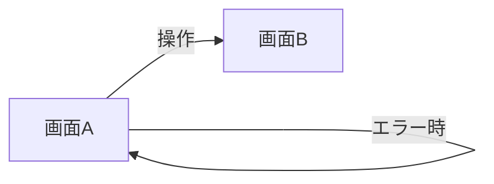
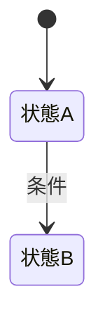

# <機能名> 概要設計

<!--
使い方（このコメントは削除しない。各機能のファイルにコピーしたら、この中は読み飛ばしてよい）

- 置き場: docs/design/<機能>.md。<機能> は画面モックのディレクトリ docs/design/<機能>/ と同じ名前にする
- 画像: docs/design/<機能>/images/<画面>.png（モックの HTML から書き出した通常表示。状態ごとの画像は撮らない。撮り方は同じディレクトリの README.md）
- 必須の節はすべて書く。条件付きの節は、条件に当たらなければ節ごと削除する
- 他に「正」がある情報は、ここを正にしない（下の「正の線引き」）
- 桁数の単位は文字数（Unicode のコードポイント。Go の utf8.RuneCountInString と同じ）
- 実装・モックの変更で内容が変わったら、同じ PR でこのファイルも更新する。版フォルダは作らない（git の履歴で管理する）
- 詳細設計は openapi/ の YAML（OpenAPI Design First。docs/architecture.md §4）。BE・FE はそこから生成する

正の線引き
| 情報 | 正 | このファイルでの扱い |
|---|---|---|
| 画面の見た目・文言・状態別の表示 | HTML モック docs/design/<機能>/*.html | 通常表示の画像を載せる。状態ごとの見え方は表に書き、画像にしない |
| 入力桁数・データ型・文字種・入力制約・必須（表の ★ 列） | 詳細設計の後は OpenAPI（openapi/ の YAML）。業務の制約は Domain の VO でも保証する | ここで決め、詳細設計で OpenAPI に転記する。食い違ったら OpenAPI が正 |
| 相関ルール（複数の項目・レコードにまたがる、あってはならない状態） | 詳細設計の後は OpenAPI の x-correlation-rules。実装は UseCase | 条件付きの「相関ルール」に業務の言葉で書き、詳細設計で「常に真になる条件」として転記する。id は CR の rule id と揃える |
| 入力制御・表示桁数・初期表示・出力仕様 | このファイル | 最後までここが正 |
| テーブル・カラム | backend/migrations/*.sql（docs/db は副次資料） | 使うテーブルへのリンクと、新規・変更の案だけ書く |
-->

| | |
|---|---|
| 対象要件 | [`docs/specifications.md`](../specifications.md) §x |
| 関連する設計 | [`docs/superpowers/specs/<日付>-<機能>-design.md`](../superpowers/specs/) |
| モック | [`docs/design/<機能>/`](./<機能>/README.md) |
| Updated | YYYY-MM-DD |

---

# 必須

## 1. カスタマージャーニー

<!-- 機能のまとまり単位で 1 つ。利用者が何を達成したいかから書く（「一覧を見る」ではなく「次に読む本の参考にする」） -->

| 段階 | ユーザーがしたいこと | 操作する画面 | 気持ち・つまずきやすい点 |
|---|---|---|---|
| | | | |

## 2. 画面遷移図

<!--
- 正常な遷移に加え、エラー時の遷移先も書く
- 登録・編集の保存に成功したときの遷移先と完了の知らせ方を書く
- 通信の失敗・サーバーのエラー（5xx）で保存できなかったら、同じ画面に入力内容を残し、もう一度保存できるようにする。競合・対象が存在しないなど、もう一度保存しても解決しないものは、機能ごとに遷移先と入力内容の扱いを書く
-->

## 3. 権限

<!-- ○: 表示・操作できる / 閲覧: 表示のみ / -: 表示しない。利用者はゲスト（誰でも）と自分（ログイン済み）の 2 種類だけ -->

| 画面・項目・操作 | ゲスト | 自分（ログイン済み） |
|---|---|---|
| | | |

## 4. 画面と入出力項目

<!--
- 1 画面ごとに「画像（通常表示）→ 入出力項目一覧 → 状態」の順に並べる
- モックに番号バッジは無い。表の No. は項目の並び順
- ★ の列は詳細設計で OpenAPI に転記する
- 入力制約★ は 1 つの項目で完結する制約だけ。複数の項目・レコードにまたがる規則は、業務上あってはならない状態なら条件付きの「相関ルール」に書き、詳細設計で x-correlation-rules に転記する。システムとして担保するだけの規則（タグ ID に重複が無い など）はここに書かず、詳細設計の x-correlation-rules にだけ書く
- 対応データ: テーブル.カラム。画面だけで持つ値は「-」
-->

### 4-1. <画面名>

*モック `<画面>.html` / 通常表示。番号は図に無い。表の No. は項目の並び順*

| No. | 項目名 | 対応データ | 入力制御 | 表示桁数 | 入力桁数★ | データ型★ | 文字種★ | 入力制約★ | 初期表示 | 出力仕様 | 必須★ |
|---|---|---|---|---|---|---|---|---|---|---|---|
| 1 | | | | | | | | | | | |

**状態**

<!-- モックで表現した状態のうち、この画面に当たるものを書く（0 件・操作不可とその理由・入力エラー・システムエラーなど）。画像は撮らない -->

| 状態 | 見え方 | 押せるもの・次にできること | モックでの出し方 |
|---|---|---|---|
| 入力エラー | | | |

## 5. メッセージ一覧

<!--
- 入力チェックのメッセージは frontend/architecture.md §2.2 の 4 つを守る（責めない・形式や条件を示す・専門用語を使わない・入力欄のすぐ近くに出す）
- 制約の種類ごとの共通のメッセージ（「〇〇を入力してください」「100 文字以内にしてください」など）は書かない（FE の対応表 web/src/utils/errorMessages.ts の ERROR_MESSAGES が正）
- 書くのは機能に固有のもの（相関ルールの違反・業務ルールの違反・確認・完了など）。モックに出る文言はモックから書き写し、モックに出ないものはここで決める
- ここの ID（MSG-xx）は、詳細設計で OpenAPI の x-correlation-rules・x-error-codes の message から参照され、FE の対応表に写す
-->

| ID | 種類 | 文言 | 表示するとき | 表示場所 |
|---|---|---|---|---|
| MSG-01 | エラー / 確認 / 完了 | | | 入力欄の下 / 画面上部 / ダイアログ / トースト |

## 6. テーブル構成

<!-- 使う既存テーブルへのリンクと、新規・変更するテーブルの案だけ。migration がマージされたら案は消し、リンクだけにする -->

使う既存テーブル: [docs/db/backend-schema.md](../db/backend-schema.md) の `xxx`、`yyy`

| テーブル | カラム | 型 | NULL | 既定値 | 意味 |
|---|---|---|---|---|---|
| | | | | | |

## 7. CRUD 表

<!-- 行は画面の操作またはバッチ。C: 作成 / R: 参照 / U: 更新 / D: 削除 -->

| 操作 | table_a | table_b |
|---|---|---|
| | | |

---

# 条件付き

<!-- 条件に当たらない節は削除する -->

## 相関ルール（あってはならない状態）

<!--
条件: 複数の項目・レコードにまたがる、業務上あってはならない状態があるとき
- 「あってはならない状態」を業務の言葉で書く（例: 同じ ISBN の本が 2 冊登録される）
- 詳細設計で OpenAPI の x-correlation-rules に、常に真になる条件として実装に寄せて転記する（例: 登録する ISBN の本は未登録である）。id は下の rule id と揃え、違反は 400 の errors[{field, rule}] で返す（docs/architecture.md §4）
-->

| ID | rule id | あってはならない状態 | 関係する項目・データ | 起こりうる操作 | メッセージ |
|---|---|---|---|---|---|
| CR-01 | | | | | MSG-xx |

## 一覧の並び順・ページング・検索条件

<!-- 条件: 一覧画面があるとき -->

| 画面 | 並び順 | 1 回の件数 | 検索・絞り込み条件 | 0 件のとき |
|---|---|---|---|---|
| | | | | |

## 外部連携の取り決め

<!-- 条件: openBD などの外部サービスを使うとき -->

| 連携先 | 何をやりとりするか | タイミング | エラー時の処理 | リトライ |
|---|---|---|---|---|
| | | | | |

## 状態遷移図と、同時実行・冪等の方針

<!-- 条件: ステータスや版を持つとき。二重押下・再送が起こるときは方針も書く -->

| 起こりうること | 方針 |
|---|---|
| 同時に 2 か所から同じものを更新する | |
| 二重押下・再送 | |

## 画面アクション定義

<!-- 条件: 認証認可など複雑な処理。イベント: 画面表示時 / クリック / 入力値の変更 / 送信・二重押下 / 戻る・画面離脱 -->

| No. | イベント | 処理 | 結果・遷移先 | メッセージ |
|---|---|---|---|---|
| | | | | |
