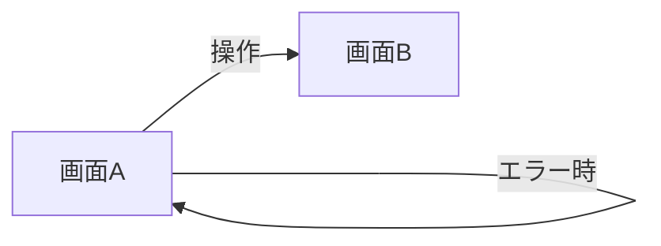
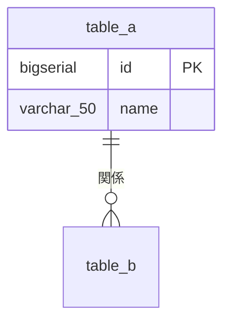
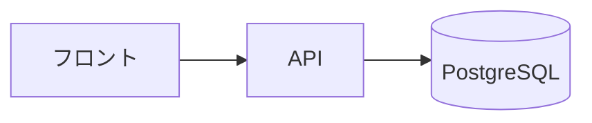
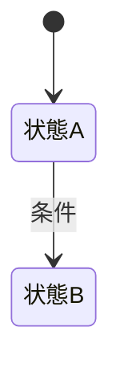

# <機能名> 概要設計

<!--
使い方（このコメントは削除しない。各機能のファイルにコピーしたら、この中は読み飛ばしてよい）

- 置き場: docs/design/<機能>.md。<機能> は mock/<機能>/ と同じ名前にする
- 画像: docs/design/<機能>/images/<画面>.png（通常表示だけ。状態ごとの画像は撮らない）
- 必須の節はすべて書く。条件付きの節は、条件に当たらなければ節ごと削除する
- 他に「正」がある情報は、ここを正にしない（下の「正の線引き」）
- 桁数の単位は文字数（OpenAPI の maxLength に合わせる。1 文字は Unicode のコードポイントで数える）
- 実装・モックの版上げで内容が変わったら、同じ PR でこのファイルも更新する。版フォルダは作らない（git の履歴で管理する）

正の線引き
| 情報 | 正 | このファイルでの扱い |
|---|---|---|
| 画面の見た目・文言・状態別の表示 | 合意済みモック mock/<機能>/v<n>/ | 通常表示のスクリーンショットとモックの版を載せる。状態ごとの見え方は表に書き、画像にしない |
| 入力桁数・データ型・文字種・入力制約・必須（表の ★ 列） | 詳細設計の後は OpenAPI（openapi/<area>/<channel>/） | ここで決め、詳細設計で OpenAPI に転記する。食い違ったら OpenAPI が正 |
| 入力制御・表示桁数・初期表示・出力仕様 | このファイル | 最後までここが正 |
| テーブル・カラム | migration がマージされた後は backend/migrations/*.sql（docs/db は副次資料） | 新規・変更の案だけ書き、マージ後は backend/migrations と docs/db へのリンクに置き換える |

スクリーンショットの撮り方
1. mock/<機能>/v<n>/ で `python3 -m http.server 8765 --bind 127.0.0.1` を起動する（ブラウザの自動操作は file:// を開けないため）
2. ブラウザ（Playwright など）で `http://127.0.0.1:8765/<画面>.html?annotate=1` を開き、PC 向けは幅 1280、スマホ向けは幅 390 でページ全体を撮り、docs/design/<機能>/images/<画面>.png に保存する
3. 保存した画像を開き、フォントが読み込まれて崩れていないことを確かめる
-->

| | |
|---|---|
| 対象ストーリー | US-xxx（[backlog.md](../requirements/backlog.md)） |
| 関連する論点 | Q-xxx（すべて決定済み） |
| 合意済みモック | [mock/<機能>/v<n>/](../../mock/<機能>/v<n>/index.html) |
| Updated | YYYY-MM-DD |

---

# 必須

## 1. カスタマージャーニー

<!-- 機能のまとまり単位で 1 つ。モックを作る前に整理した User Purpose → Task を流用してよい。同じジャーニーを他の機能と共有するならリンクだけ書く -->

| 段階 | ユーザーがしたいこと | 操作する画面 | 気持ち・つまずきやすい点 |
|---|---|---|---|
| | | | |

## 2. 画面遷移図

<!--
- 正常な遷移に加え、エラー時の遷移先も書く
- 新規登録・編集の保存に成功したら、詳細画面がある機能は詳細画面へ、詳細画面が無く編集画面が詳細を兼ねる機能は一覧画面へ移り、完了を知らせる
- 通信の失敗・サーバーのエラー（5xx）で保存できなかったら、同じ画面に入力内容を残し、もう一度保存できるようにする。競合・対象が存在しない・権限が無いなど、もう一度保存しても解決しないものは、機能ごとに遷移先と入力内容の扱いを書く
-->

## 3. 権限

<!-- ○: 表示・操作できる / 閲覧: 表示のみ / -: 表示しない -->

| 画面・項目・操作 | ゲスト | 自分（ログイン済み） |
|---|---|---|
| | | |

## 4. 画面と入出力項目

<!--
- 1 画面ごとに「スクリーンショット（通常表示）→ 入出力項目一覧 → 状態」の順に並べる
- スクリーンショットはモックを ?annotate=1 付きで開いて撮る（番号バッジが表示される）。番号は表の No. と一致させる
- ★ の列は詳細設計で OpenAPI に転記する
- 入力制約★ は 1 つの項目で完結する制約だけ。複数の項目・レコードにまたがる規則は、業務上あってはならない状態なら条件付きの「相関ルール」に書き、詳細設計で x-correlation-rules に転記する。システムとして担保するだけの規則（削除対象の ID に重複が無い など）はここに書かず、詳細設計の x-correlation-rules にだけ書く
- 対応データ: テーブル.カラム。画面だけで持つ値は「-」
-->

### 4-1. <画面名>

*モック v<n> / 通常表示。番号は下表の No. に対応*

| No. | 項目名 | 対応データ | 入力制御 | 表示桁数 | 入力桁数★ | データ型★ | 文字種★ | 入力制約★ | 初期表示 | 出力仕様 | 必須★ |
|---|---|---|---|---|---|---|---|---|---|---|---|
| 1 | | | | | | | | | | | |

**状態**

<!--
- モックで表現した状態のうち、この画面に当たるものを書く（0件・操作不可とその理由・期限切れ・入力エラー・システムエラーなど）
- 画像は撮らない。見た目の正はモックで、レビューではモックを「モックでの出し方」のとおりに操作して確かめる
-->

| 状態 | 見え方 | 押せるもの・次にできること | モックでの出し方 |
|---|---|---|---|
| 入力エラー | | | |

## 5. メッセージ一覧

<!--
- 入力チェックのメッセージは frontend/architecture.md §4「入力チェックのメッセージ」の 4 つを守る（責めない・形式や条件を示す・専門用語を使わない・入力欄のすぐ近くに出す）
- 種類は分類のための列で、画面には出さない
- 入力チェックの表示場所は「入力欄の下」か「入力欄の横」。画面上部には入力欄に対応しないものと、入力欄のエラーがあることを知らせる件数付きの短い案内（「入力内容を確認してください（N件）」）だけを出す
- 制約の種類ごとの共通のメッセージ（「〇〇を入力してください」「100 文字以内で入力してください」など）は書かない（FE の実装が正）
- 書くのは機能に固有のもの（相関ルールの違反・業務ルールの違反・確認・完了など）。モックに出る文言はモックから書き写し、モックに出ないもの（API が返す業務ルールの違反など）はここで決める
- ここの ID（MSG-xx）は、詳細設計で OpenAPI の x-correlation-rules・x-error-codes の message から参照される
- BE しか知らない値（残りの回数・待ち時間など）は {retryAfterSeconds} のように差し込む位置を書く。キー名は詳細設計で OpenAPI の params と揃える
-->

| ID | 種類 | 文言 | 表示するとき | 表示場所 |
|---|---|---|---|---|
| MSG-01 | エラー / 確認 / 完了 | | | 入力欄の下 / 画面上部 / ダイアログ / トースト |

## 6. テーブル構成

<!-- 新規・変更するテーブルの案だけ。書式は docs/db/backend-schema.md と同じ。migration がマージされたら、この節を SQL の正（backend/migrations/）とスキーマ資料（docs/db/backend-schema.md）へのリンクに置き換える -->

使う既存テーブル: [docs/db/backend-schema.md](../db/backend-schema.md) の `xxx`、`yyy`

| テーブル | カラム | 型 | NULL | 既定値 | 意味 |
|---|---|---|---|---|---|
| | | | | | |

## 7. CRUD 表

<!-- 行は画面の操作またはバッチ。C: 作成 / R: 参照 / U: 更新 / D: 削除 -->

| 操作 | table_a | table_b |
|---|---|---|
| | | |

---

# 条件付き

<!-- 条件に当たらない節は削除する -->

## アーキテクチャ図

<!-- 条件: バッチや簡単な API 以外 -->

## 外部連携の取り決め

<!-- 条件: 外部のサービス（外部カタログ・決済・メール送信など）を使うとき -->

| 連携先 | 何をやりとりするか | タイミング | エラー時の処理 | リトライ |
|---|---|---|---|---|
| | | | | |

## 相関ルール（あってはならない状態）

<!--
条件: 複数の項目・レコードにまたがる、業務上あってはならない状態があるとき。システム観点でも重大になりうる規則もここで決める
- 「あってはならない状態」を業務の言葉で書く（例: 同じ ISBN の本が 2 冊登録される）
- 詳細設計で OpenAPI の x-correlation-rules に、常に真になる条件として実装に寄せて転記する（例: 登録する ISBN の本は未登録である）。id は下の ID と揃える
-->

| ID | あってはならない状態 | 関係する項目・データ | 起こりうる操作 | メッセージ |
|---|---|---|---|---|
| CR-01 | | | | MSG-xx |

## 状態遷移図と、同時実行・冪等の方針

<!-- 条件: ステータスが条件によって変わるとき。同じデータの同時更新・二重押下など同時実行や再送が起こるときは方針も書く -->

| 起こりうること | 方針 |
|---|---|
| 同時に 2 か所から同じデータを保存する | |
| 二重押下・再送 | |

## 画面アクション定義

<!--
条件: 認証認可など複雑な処理
イベント: 画面表示時 / タップ・クリック / 長押し / スワイプ / 入力値の変更・フォーカスアウト / 送信・二重押下 / 戻る・画面離脱
マウスオーバー・右クリックは管理画面（PC）だけで使う。公開画面ではホバーでしか見えない情報を作らない
-->

| No. | イベント | 処理 | 結果・遷移先 | メッセージ |
|---|---|---|---|---|
| | | | | |

## 帳票

<!-- 条件: PDF・CSV・レポートを出力するとき -->

| No. | 項目名 | 対応データ | フォーマット | 表示桁数 | 出力編集（計算式など） |
|---|---|---|---|---|---|
| | | | | | |

## バッチ処理フロー

<!-- 条件: バッチがあるとき。抽出・加工・更新は分けて書く -->

| 順 | 処理 | 入力 | 出力 | 失敗時・再実行 |
|---|---|---|---|---|
| 1 | | | | |

起動: <スケジュール・きっかけ>

## 一覧の並び順・ページング・検索条件

<!-- 条件: 一覧画面があるとき -->

| 画面 | 並び順 | 1 ページの件数 | 検索・絞り込み条件 | 0 件のとき |
|---|---|---|---|---|
| | | | | |
