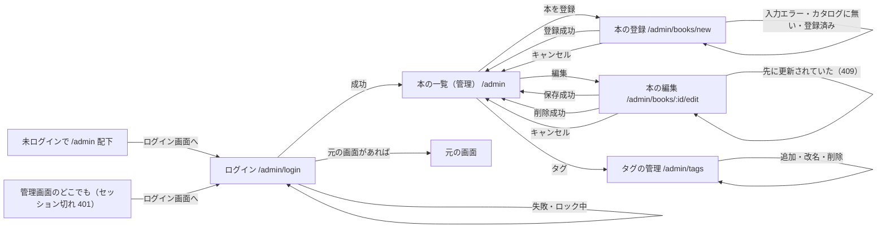
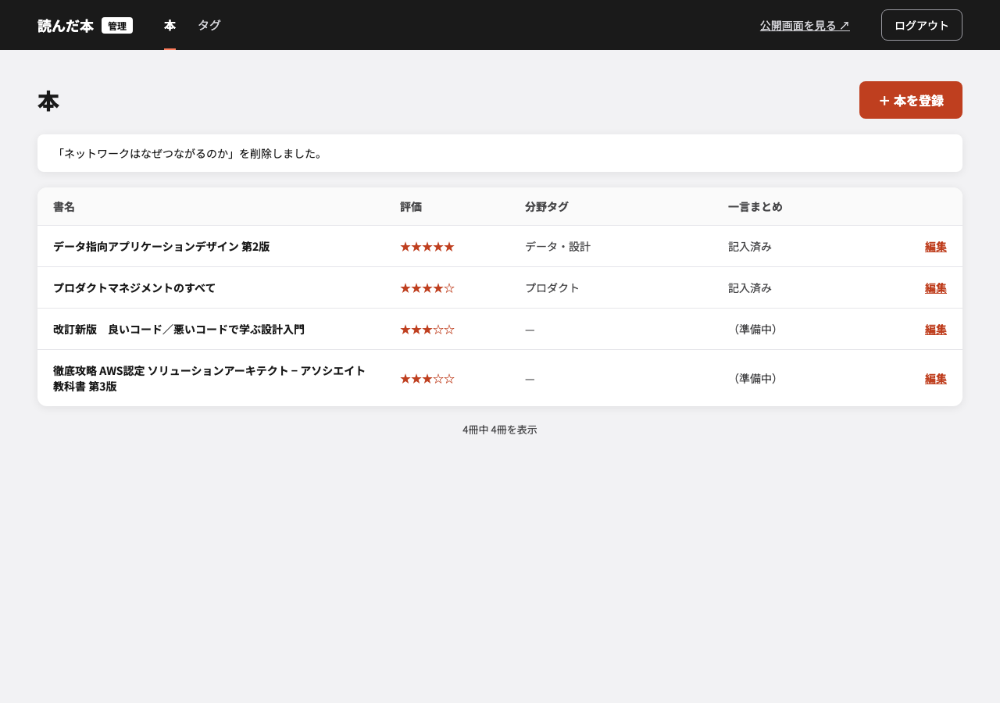
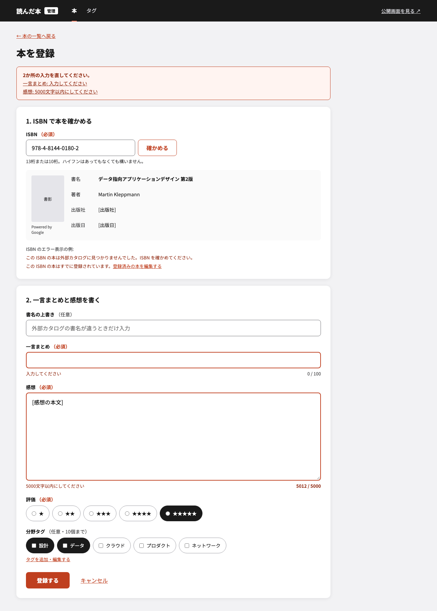
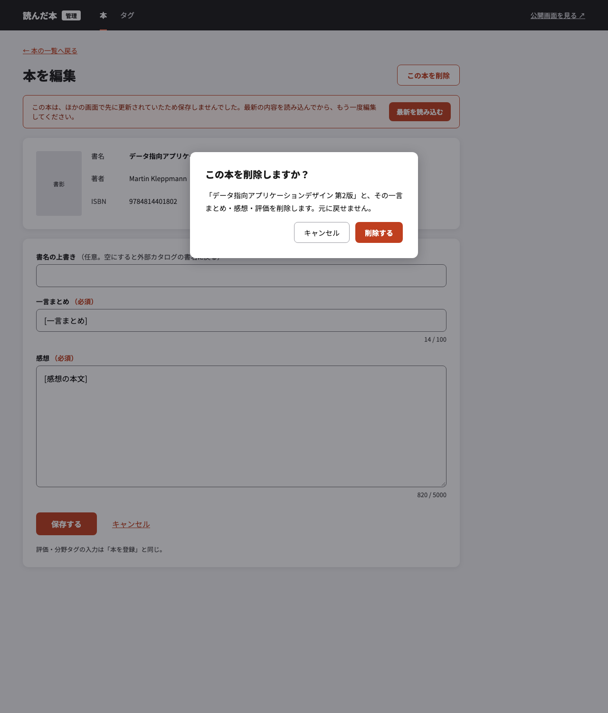
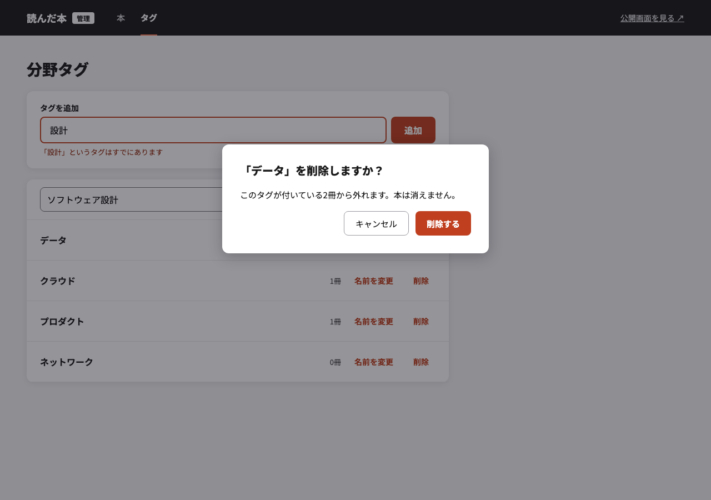
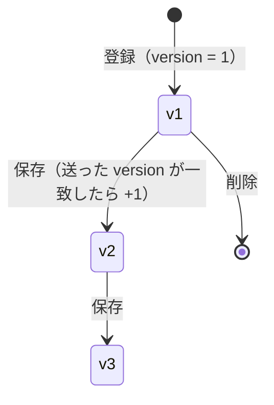

# 管理画面 概要設計

<!-- 書き方は _template.md。実装済みの機能を後追いで設計書にしたもの。モック・要件・コードから確認できる事実だけを書き、確認できないものは「未決」と書く -->

| | |
|---|---|
| 対象要件 | [`docs/specifications.md`](../specifications.md) §1・§3 |
| 関連する設計 | [`2026-09-30-admin-screens-design.md`](../superpowers/specs/2026-09-30-admin-screens-design.md)・[`2026-09-30-admin-login-design.md`](../superpowers/specs/2026-09-30-admin-login-design.md)・[`2026-09-28-reading-api-design.md`](../superpowers/specs/2026-09-28-reading-api-design.md)・[`2026-09-28-title-override-summary-design.md`](../superpowers/specs/2026-09-28-title-override-summary-design.md) |
| モック | [`docs/design/admin-screens/`](./admin-screens/README.md)（ログイン画面のモックは無い） |
| Updated | 2026-11-02 |

---

# 必須

## 1. カスタマージャーニー

| 段階 | ユーザーがしたいこと | 操作する画面 | 気持ち・つまずきやすい点 |
|---|---|---|---|
| 入る | 自分だけが書き込める状態にしたい | ログイン | 失敗が続いてしばらく拒否されても、理由が分かれば待てる |
| 登録 | 読み終えた本を、感想を書いて公開したい | 本の登録 | ISBN を打ち間違える。登録済みか忘れている。入力の誤りが一度に全部分かると直しやすい |
| 直す | 感想や評価を書き直したい。書名の表記を直したい | 本の一覧（管理）→ 本の編集 | 別のタブで先に直した変更を上書きしたくない |
| 整理 | 分野タグを増やす・名前を直す・使わないものを消したい | タグの管理 | タグを消すと本から外れるが、本は消えないと分かれば安心して消せる |

## 2. 画面遷移図

- 登録・保存・削除に成功したら本の一覧（管理）へ戻り、完了のお知らせを出す（お知らせは遷移の state で渡す）
- 通信の失敗・サーバーのエラー（5xx）で保存できなかったときは、同じ画面に入力内容を残し、画面上部に FE 共通の文言を出して、もう一度保存できる
- 本の編集で先に更新されていたとき（409）は、同じ画面に入力内容を残して MSG-A06 を出し、「最新を読み込む」で取り直す（自動で再送しない）
- タグの改名で先に更新されていたとき（409）は、一覧を取り直して MSG-A08 を出す

## 3. 権限

| 画面・項目・操作 | ゲスト | 自分（ログイン済み） |
|---|---|---|
| ログイン画面 | ○ | ○（未決: ログイン済みで開いたときに本の一覧（管理）へ送るかは実装していない） |
| 本の一覧（管理）・本の登録・本の編集・タグの管理の表示 | - | ○ |
| 登録・保存・削除・タグの追加・改名・削除 | - | ○ |

- ログイン済みかはサーバー側のセッション（httpOnly Cookie `admin_session`）で判定する。操作が無いまま 1 時間、またはログインから 24 時間で切れる。ログアウトで即座に切れる
- 書き込みの API は、セッションに加えて同一オリジン（Origin と Host の一致）を要求する（403）
- 利用者は自分 1 人なので、ユーザー管理・権限の種類は持たない

## 4. 画面と入出力項目

### 4-1. ログイン

モック無し（設計は [ログインの設計](../superpowers/specs/2026-09-30-admin-login-design.md)）。

| No. | 項目名 | 対応データ | 入力制御 | 表示桁数 | 入力桁数★ | データ型★ | 文字種★ | 入力制約★ | 初期表示 | 出力仕様 | 必須★ |
|---|---|---|---|---|---|---|---|---|---|---|---|
| 1 | ID | 環境変数 `ADMIN_ID`（DB に無い） | - | - | 上限なし | 文字列 | 制限なし | - | 空 | - | 必須 |
| 2 | パスワード | 環境変数 `ADMIN_PASSWORD_HASH` と照合（DB に無い） | 入力を画面に出さない | - | 上限なし | 文字列 | 制限なし | - | 空 | - | 必須 |
| 3 | ログイン | - | 送信中は押せない | - | - | - | - | - | - | 成功で 204。セッション Cookie を発行 | - |

**状態**

| 状態 | 見え方 | 押せるもの・次にできること | モックでの出し方 |
|---|---|---|---|
| ID またはパスワードが違う（401）・ロック中（429）・ID 未設定（403） | 画面上部に MSG-A09（どちらが違うかは伝えない。要件 §3.1） | 入力を直してもう一度 | モック無し |
| 通信失敗・5xx | 画面上部に MSG-A09 | もう一度 | モック無し |

### 4-2. 本の一覧（管理）

*モック `books.html` / 通常表示。番号は図に無い。表の No. は項目の並び順*

| No. | 項目名 | 対応データ | 入力制御 | 表示桁数 | 入力桁数★ | データ型★ | 文字種★ | 入力制約★ | 初期表示 | 出力仕様 | 必須★ |
|---|---|---|---|---|---|---|---|---|---|---|---|
| 1 | 本を登録 | - | 本の登録へ | - | - | - | - | - | - | - | - |
| 2 | 完了のお知らせ | 遷移の state | 登録・保存・削除の直後だけ出す | - | - | - | - | - | 無し | MSG-A10 / A11 / A12 | - |
| 3 | 本の表（書名・評価・分野タグ・一言まとめ・編集） | book.title（上書きがあれば title_override）/ rating / tag.name / summary | 「編集」で本の編集へ | 全文 | - | - | - | - | 新しく登録した順に 20 冊（公開の一覧と同じ API） | 一言まとめは「記入済み」か「（準備中）」で出す（モック） | - |
| 4 | N冊中 M冊を表示 / もっと見る | - | 公開の一覧と同じ | - | - | - | - | - | - | - | - |

**状態**

| 状態 | 見え方 | 押せるもの・次にできること | モックでの出し方 |
|---|---|---|---|
| 0 件 | 本が無いことを伝える（公開の一覧と同じ部品） | 本を登録 | モックには無い（`states.html` の 0 件と同じ部品） |
| 読み込み失敗 | FE 共通のエラー表示 | 再試行 | 同上 |

### 4-3. 本の登録

*モック `book-new.html` / 入力エラーと ISBN のエラーの例を重ねて描いている。番号は図に無い。表の No. は項目の並び順*

| No. | 項目名 | 対応データ | 入力制御 | 表示桁数 | 入力桁数★ | データ型★ | 文字種★ | 入力制約★ | 初期表示 | 出力仕様 | 必須★ |
|---|---|---|---|---|---|---|---|---|---|---|---|
| 1 | ISBN | book.isbn（ハイフンを除いた 13 桁で保存。10 桁は 13 桁に変換） | 「確かめる」で外部カタログを照会し、書誌と書影を 2〜5 に出す。確かめていない ISBN では登録できない | - | 17 | 文字列 | 数字・ハイフン（10 桁はチェックディジット X 可） | 13 桁または 10 桁で、チェックディジットが合う（VO） | 空 | - | 必須 |
| 2 | 書影 | 外部カタログの URL（book.cover_url / cover_source） | - | - | - | - | - | - | 「確かめる」の結果 | 無ければ「書影なし」の枠 | - |
| 3〜5 | 書名・著者・出版社・出版日 | 外部カタログの値（book.title / authors / publisher / published_on） | 編集できない | 全文 | - | - | - | - | 「確かめる」の結果 | - | - |
| 6 | 書名の上書き | book.title_override | 前後の空白を除く。空なら上書きしない | 全文 | 255 | 文字列 | タブ・改行は不可 | - | 空 | - | 任意 |
| 7 | 一言まとめ | book.summary | 前後の空白を除く。文字数（N / 100）を添える | 全文 | 100 | 文字列 | タブ・改行は不可 | - | 空 | - | 必須 |
| 8 | 感想 | book.comment | 改行できる。文字数（N / 5000）を添える | 全文 | 5000 | 文字列 | 改行可。タブ・制御文字は不可 | - | 空 | - | 必須 |
| 9 | 評価 | book.rating | 星 1〜5 のラジオ | - | - | 整数 | - | 1〜5 | 未選択 | - | 必須 |
| 10 | 分野タグ | book_tag.tag_id | チェックボックス。「タグを追加・編集する」でタグの管理へ | - | 0〜10 個 | 整数の配列 | - | 実在するタグの ID（CR-03）。重複なし（詳細設計のみ） | 未選択 | - | 任意 |
| 11 | 登録する | - | 送信中は押せない。送信前に FE でも同じ上限を確かめる | - | - | - | - | - | - | 成功で本の一覧（管理）へ戻り MSG-A10 | - |
| 12 | キャンセル | - | 入力を捨てて本の一覧（管理）へ | - | - | - | - | - | - | - | - |

- 登録時に書誌と書影を外部カタログから取得して保存する。画面で確かめた値をそのまま送るのではなく、API がもう一度照会する（外部連携の取り決め）
- 入力の誤りは、画面上部の MSG-A07（各項目へのリンク付き）と、項目ごとの文言の両方で出す。サーバーの 400 の `errors[{field, rule}]` も同じ場所に出す（文言は FE の対応表 `web/src/utils/serverFieldErrors.ts`）

**状態**

| 状態 | 見え方 | 押せるもの・次にできること | モックでの出し方 |
|---|---|---|---|
| ISBN を確かめる前 | 書誌・書影の枠は空 | ISBN を入れて「確かめる」 | 通常表示 |
| カタログに無い ISBN（確かめる: 404 / 登録: 400 `isbnNotInCatalog`） | ISBN の下に MSG-A02 | ISBN を直して「確かめる」 | 図の「ISBN のエラー表示の例」 |
| 登録済みの ISBN（登録: 400 `isbnDuplicated`） | ISBN の下に MSG-A01 と「登録済みの本を編集する」 | 本の編集へ | 同上 |
| ISBN の形式が不正（確かめる: 400 / 登録: 400 `format`） | ISBN の下に MSG-A05 | ISBN を直す | モックには無い |
| 入力エラー（FE の検証・サーバーの 400） | 画面上部に MSG-A07、各入力欄の下に個別の文言 | 直して登録 | 図の上部（「2か所の入力を直してください。」） |
| 選んだタグが削除済み（400 `tagIdsNotFound`） | 分野タグの下に MSG-A03 | タグを選び直す（タグ一覧を取り直す） | モックには無い |
| 登録失敗（通信・5xx・想定外の 409） | 同じ画面に入力を残し、画面上部に FE 共通の文言 | もう一度登録 | モックには無い |
| セッション切れ（401） | ログイン画面へ送る。ログインしたら元の画面へ戻す | - | モックには無い |

### 4-4. 本の編集・削除

*モック `book-edit.html` / 先に更新されていたときの表示と削除の確認ダイアログを重ねて描いている。番号は図に無い。表の No. は項目の並び順*

| No. | 項目名 | 対応データ | 入力制御 | 表示桁数 | 入力桁数★ | データ型★ | 文字種★ | 入力制約★ | 初期表示 | 出力仕様 | 必須★ |
|---|---|---|---|---|---|---|---|---|---|---|---|
| 1 | この本を削除 | - | 確認ダイアログを開く | - | - | - | - | - | - | - | - |
| 2 | 書影・書名・著者・ISBN | 外部カタログの値と book.isbn | 編集できない | 全文 | - | - | - | - | 登録値 | - | - |
| 3 | 書名の上書き | book.title_override | 全体の置き換え。空にすると外部カタログの書名に戻る | 全文 | 255 | 文字列 | タブ・改行は不可 | - | 登録値 | - | 任意 |
| 4 | 一言まとめ | book.summary | 本の登録と同じ | 全文 | 100 | 文字列 | タブ・改行は不可 | - | 登録値 | - | 必須 |
| 5 | 感想 | book.comment | 本の登録と同じ | 全文 | 5000 | 文字列 | 改行可 | - | 登録値 | - | 必須 |
| 6 | 評価 | book.rating | 本の登録と同じ | - | - | 整数 | - | 1〜5 | 登録値 | - | 必須 |
| 7 | 分野タグ | book_tag.tag_id | 本の登録と同じ。全体の置き換え（空なら全部外す）。初期値は名前から ID に引き直す | - | 0〜10 個 | 整数の配列 | - | 実在するタグの ID（CR-03）。重複なし（詳細設計のみ） | 登録値 | - | 任意 |
| 8 | version | book.version | 画面に出さない。編集開始時（または最新を読み込んだ時）の値を保存に添える | - | - | 整数 | - | 保存時に一致（楽観ロック） | 登録値 | - | 必須 |
| 9 | 保存する | - | 送信中は押せない | - | - | - | - | - | - | 成功で本の一覧（管理）へ戻り MSG-A11。書誌と書影は外部カタログから取り直す | - |
| 10 | キャンセル | - | 入力を捨てて本の一覧（管理）へ | - | - | - | - | - | - | - | - |
| 11 | 削除の確認ダイアログ | - | 開いたらキャンセルにフォーカス。Esc で閉じる。「削除する」でだけ削除する | - | - | - | - | - | - | 成功で本の一覧（管理）へ戻り MSG-A12 | - |

**状態**

| 状態 | 見え方 | 押せるもの・次にできること | モックでの出し方 |
|---|---|---|---|
| 読み込み中 | 「読み込み中…」 | - | モックには無い |
| 存在しない本（404） | 見つからない表示 | 本の一覧（管理）へ | モックには無い |
| 入力エラー | 本の登録と同じ | 直して保存 | 本の登録のモック |
| 先に更新されていた（409） | 画面上部に MSG-A06 と「最新を読み込む」。入力は残る | 「最新を読み込む」で取り直してから保存し直す | 図の上部 |
| 選んだタグが削除済み（400 `tagIdsNotFound`） | 分野タグの下に MSG-A03 | タグを選び直す | モックには無い |
| 削除の確認 | ダイアログ MSG-A13 | 「削除する」「キャンセル」 | 図の下部 |
| 削除失敗 | ダイアログ内に「削除できませんでした。時間をおいてもう一度お試しください。」 | もう一度・キャンセル | モックには無い |

### 4-5. タグの管理

*モック `tags.html` / 同名の追加・名前の変更中の行・削除の確認ダイアログを重ねて描いている。番号は図に無い。表の No. は項目の並び順*

| No. | 項目名 | 対応データ | 入力制御 | 表示桁数 | 入力桁数★ | データ型★ | 文字種★ | 入力制約★ | 初期表示 | 出力仕様 | 必須★ |
|---|---|---|---|---|---|---|---|---|---|---|---|
| 1 | タグを追加（名前） | tag.name | 前後の空白を除く | - | 30 | 文字列 | タブ・改行は不可 | 他のタグと重複しない（CR-04） | 空 | - | 必須 |
| 2 | 追加 | - | 送信中は押せない | - | - | - | - | - | - | 成功で一覧に加わる | - |
| 3 | タグの行（名前・冊数） | tag.name / book_tag の件数 | - | 全文 | - | - | - | - | 名前順。冊数 0 のタグも出す | - | - |
| 4 | 名前を変更 → 新しい名前・保存・キャンセル | tag.name / tag.version | その場の入力欄。version を保存に添える | - | 30 | 文字列 | タブ・改行は不可 | 自分以外のタグと重複しない（CR-04）。version が一致 | 登録値 | - | 必須 |
| 5 | 削除 → 確認ダイアログ | - | 「削除する」でだけ削除する | - | - | - | - | - | - | 付いていた本から外れる（本は消えない） | - |

**状態**

| 状態 | 見え方 | 押せるもの・次にできること | モックでの出し方 |
|---|---|---|---|
| 同名のタグがある（400 `tagNameDuplicated`） | 名前の入力欄の下に MSG-A04 | 名前を直す | 図の「「設計」というタグはすでにあります」 |
| 名前の変更中 | その行が入力欄・保存・キャンセルになる | 保存・キャンセル | 図の 2 行目 |
| 先に更新されていた（改名: 409） | 一覧を取り直し、MSG-A08 | 改めて名前を変更 | モックには無い |
| 削除の確認 | ダイアログ MSG-A14 | 「削除する」「キャンセル」 | 図の下部 |
| 読み込み失敗 | FE 共通のエラー表示 | 再試行 | モックには無い |

## 5. メッセージ一覧

相関ルール・業務ルールに固有のもの。制約の種類ごとの共通の文言（「入力してください」「100文字以内にしてください」など）は FE の対応表（`web/src/utils/serverFieldErrors.ts`）が正で、ここには書かない。

| ID | 種類 | 文言 | 表示するとき | 表示場所 |
|---|---|---|---|---|
| MSG-A01 | エラー | この ISBN の本はすでに登録されています。 | 登録時に同じ ISBN の本がある（CR-01） | ISBN の入力欄の下 |
| MSG-A02 | エラー | この ISBN の本は外部カタログに見つかりませんでした。ISBN を確かめてください。 | 「確かめる」で 404、または登録時に外部カタログに無い（CR-02） | ISBN の入力欄の下 |
| MSG-A03 | エラー | 選んだ分野タグのうち、すでに削除されたものがあります。タグを選び直してください。 | 登録・保存時に存在しないタグ ID がある（CR-03） | 分野タグの下 |
| MSG-A04 | エラー | この名前の分野タグはすでにあります。別の名前にしてください。 | 追加・改名時に同じ名前のタグがある（CR-04） | 名前の入力欄の下 |
| MSG-A05 | エラー | ISBN は 13 桁か 10 桁で入力してください。 | ISBN の桁・チェックディジットが合わない | ISBN の入力欄の下 |
| MSG-A06 | エラー | この本は、ほかの画面で先に更新されていたため保存しませんでした。最新の内容を読み込んでから、もう一度編集してください。 | 本の保存で version が一致しない（409） | 画面上部（「最新を読み込む」付き） |
| MSG-A07 | エラー | Nか所の入力を直してください。 | 入力エラーが 1 つ以上ある | 画面上部（各項目へのリンク付き） |
| MSG-A08 | エラー | このタグは、ほかの画面で先に更新されていました。最新の内容を読み込みました。 | タグの改名で version が一致しない（409） | 画面上部 |
| MSG-A09 | エラー | ログインできませんでした。時間をおいてもう一度お試しください。 | ログイン失敗（401・403・429・通信失敗・5xx。どれかは伝えない） | 画面上部 |
| MSG-A10 | 完了 | 本を登録しました | 登録に成功 | 本の一覧（管理）の上部 |
| MSG-A11 | 完了 | 本を更新しました | 保存に成功 | 本の一覧（管理）の上部 |
| MSG-A12 | 完了 | 『書名』を削除しました | 削除に成功 | 本の一覧（管理）の上部 |
| MSG-A13 | 確認 | この本を削除しますか？ 「書名」と、その一言まとめ・感想・評価を削除します。元に戻せません。 | 本の削除を押した | ダイアログ |
| MSG-A14 | 確認 | 「タグ名」を削除しますか？ このタグが付いている N 冊から外れます。本は消えません。 | タグの削除を押した | ダイアログ |

- MSG-A01〜A05 は API の `errors[{field, rule}]` の `rule` から FE の対応表で引く（`rule` は下の相関ルールの rule id、A05 は `format`）
- MSG-A02 の「確かめる」の 404 は従来どおりの文言で、登録時の 400 と同じ文言に揃える

## 6. テーブル構成

使う既存テーブル: [docs/db/backend-schema.md](../db/backend-schema.md) の `book`、`tag`、`book_tag`、`admin_session`。新規・変更は無い。

一意制約（`uq_book_isbn`・`uq_tag_name`）は相関ルール CR-01・CR-04 の最後の砦で、UseCase の検査をすり抜けた同時登録は制約違反（409）で止まる。

## 7. CRUD 表

| 操作 | book | tag | book_tag | admin_session |
|---|---|---|---|---|
| ログイン（`POST /api/auth/login`） | - | - | - | C |
| ログアウト（`POST /api/auth/logout`） | - | - | - | D |
| 管理画面の表示（`GET /api/auth/session`） | - | - | - | R・U（期限の延長） |
| 本の一覧（管理）（`GET /api/books`） | R | R | R | R |
| ISBN を確かめる（`GET /api/catalog/{isbn}`） | - | - | - | R |
| 本の登録（`POST /api/books`） | R（重複）・C | R（存在） | C | R |
| 本の編集の初期値（`GET /api/books/{id}`・`GET /api/tags`） | R | R | R | R |
| 本の保存（`PUT /api/books/{id}`） | R・U | R（存在） | D・C（入れ直し） | R |
| 本の削除（`DELETE /api/books/{id}`） | D | - | D（CASCADE） | R |
| タグの一覧（`GET /api/tags`・`GET /api/tags/counts`） | - | R | R | R |
| タグの追加（`POST /api/tags`） | - | R（重複）・C | - | R |
| タグの改名（`PUT /api/tags/{id}`） | - | R（重複）・U | - | R |
| タグの削除（`DELETE /api/tags/{id}`） | - | D | D（CASCADE） | R |

---

# 条件付き

## 相関ルール（あってはならない状態）

詳細設計（Handler の swag 拡張 `@x-correlation-rules`）に「常に真になる条件」として転記し、UseCase で実装する。違反は 400 の `errors[{field, rule}]` で返し、独立して判定できる違反はまとめて返す（[`docs/architecture.md`](../architecture.md) §4「バリデーションの全件返却」）。

| ID | rule id | あってはならない状態 | 関係する項目・データ | 起こりうる操作 | メッセージ |
|---|---|---|---|---|---|
| CR-01 | `isbnDuplicated` | 同じ ISBN の本が 2 冊登録される | 入力の ISBN と `book.isbn` | 本の登録（`POST /api/books`） | MSG-A01 |
| CR-02 | `isbnNotInCatalog` | 外部カタログに無い ISBN の本が登録される（書名すら分からない） | 入力の ISBN と外部カタログ（openBD） | 本の登録（`POST /api/books`） | MSG-A02 |
| CR-03 | `tagIdsNotFound` | 存在しない（削除済みの）分野タグが本に付く | 入力の分野タグ ID と `tag.id` | 本の登録・保存（`POST /api/books`・`PUT /api/books/{id}`） | MSG-A03 |
| CR-04 | `tagNameDuplicated` | 同じ名前の分野タグが 2 つある | 入力の名前と `tag.name`（改名では自分以外） | タグの追加・改名（`POST /api/tags`・`PUT /api/tags/{id}`） | MSG-A04 |

- システムとして担保するだけの規則（分野タグ ID に重複が無い `tagIdsDuplicated`）はここに書かず、詳細設計にだけ書く。FE は重複を送らないので、文言は共通の「入力を見直してください」
- 前提が成立しない検査はしない: ISBN の形式が不正なら CR-01・CR-02 は検査しない。外部カタログへの照会（CR-02）は他の違反が 1 つも無いときだけ行う

## 外部連携の取り決め

| 連携先 | 何をやりとりするか | タイミング | エラー時の処理 | リトライ |
|---|---|---|---|---|
| openBD（書誌・書影） | ISBN を渡し、書名・著者・出版社・出版日・書影の URL を受け取る。画像は保存しない | 「確かめる」（`GET /api/catalog/{isbn}`）・本の登録・本の保存のたび | 登録: 無ければ CR-02 の違反（400）。保存: 取り直せなければ今の書誌と書影のままにし、保存は止めない（要件 §1.1）。障害（タイムアウト・5xx）は登録では 5xx、保存では今の値のまま | しない |

## 状態遷移図と、同時実行・冪等の方針

本とタグに業務上のステータスは無い。版（`version`）だけを持つ。

| 起こりうること | 方針 |
|---|---|
| 同時に 2 か所から同じ本（タグ）を保存する | 楽観ロック。送った `version` が一致した方だけ保存し、もう一方は 409。本の編集は MSG-A06 と「最新を読み込む」、タグの改名は一覧を取り直して MSG-A08 |
| 同時に同じ ISBN（タグ名）を登録する | UseCase の重複検査（CR-01・CR-04）をすり抜けた側は DB の一意制約で 409。FE は想定外として画面上部に共通の文言 |
| 二重押下・再送 | FE は送信中にボタンを押せなくする（`submitting` のガード）。登録の再送は CR-01 で 400 になる。削除の再送は 404 |
| ログインの失敗が続く | 5 回で 1 分間拒否（429）。どちらが違うかは伝えない |

## 画面アクション定義

ログイン・セッションに関わるものだけ。

| No. | イベント | 処理 | 結果・遷移先 | メッセージ |
|---|---|---|---|---|
| 1 | 管理画面を表示 | `GET /api/auth/session` でログイン済みか確かめる | 401 ならログイン画面へ（元の URL を添える） | - |
| 2 | ログインを送信 | `POST /api/auth/login`。成功でセッション Cookie を受け取る | 元の URL があればそこへ、無ければ本の一覧（管理）へ | 失敗は MSG-A09 |
| 3 | 管理画面の API が 401 を返す | セッション切れとしてログイン画面へ | ログイン画面（元の URL を添える） | - |
| 4 | ログアウト | `POST /api/auth/logout`。サーバーのセッションを消し Cookie を消す | ログイン画面 | - |
