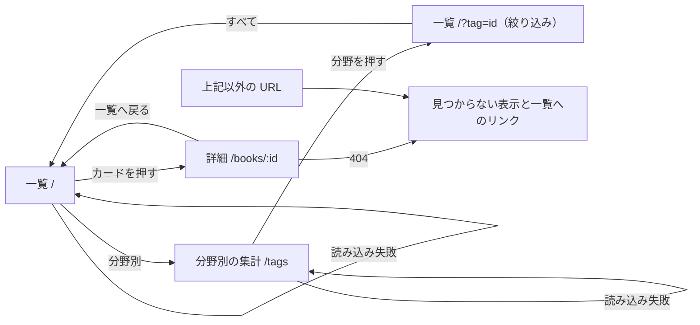
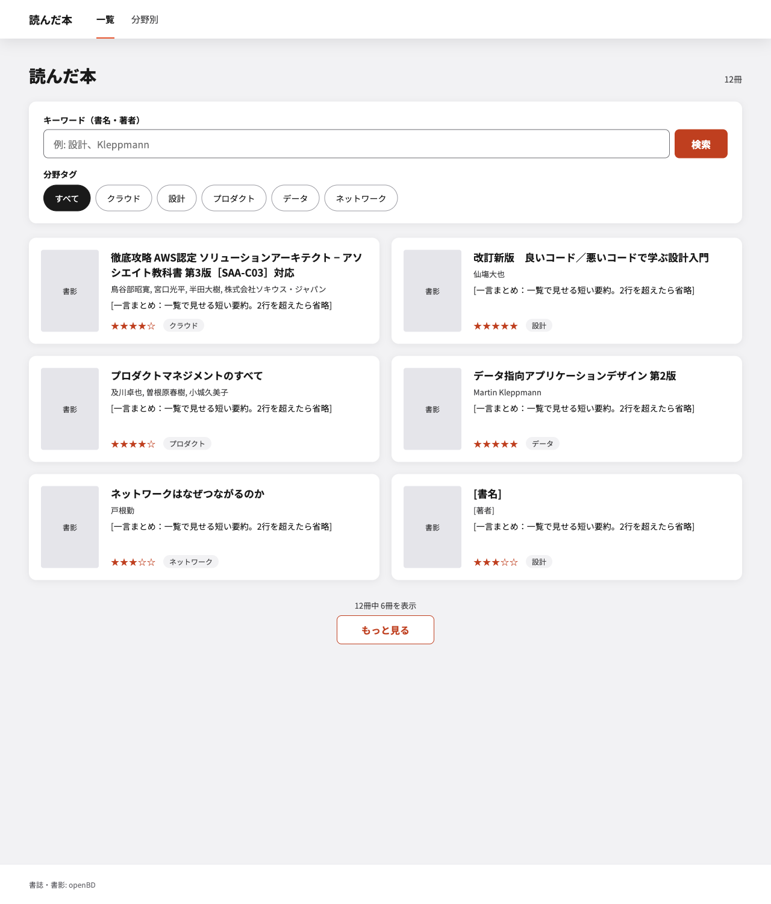
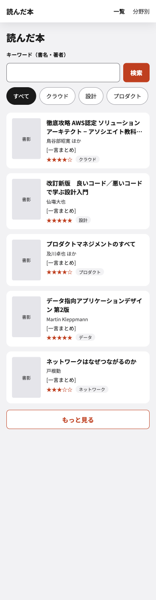
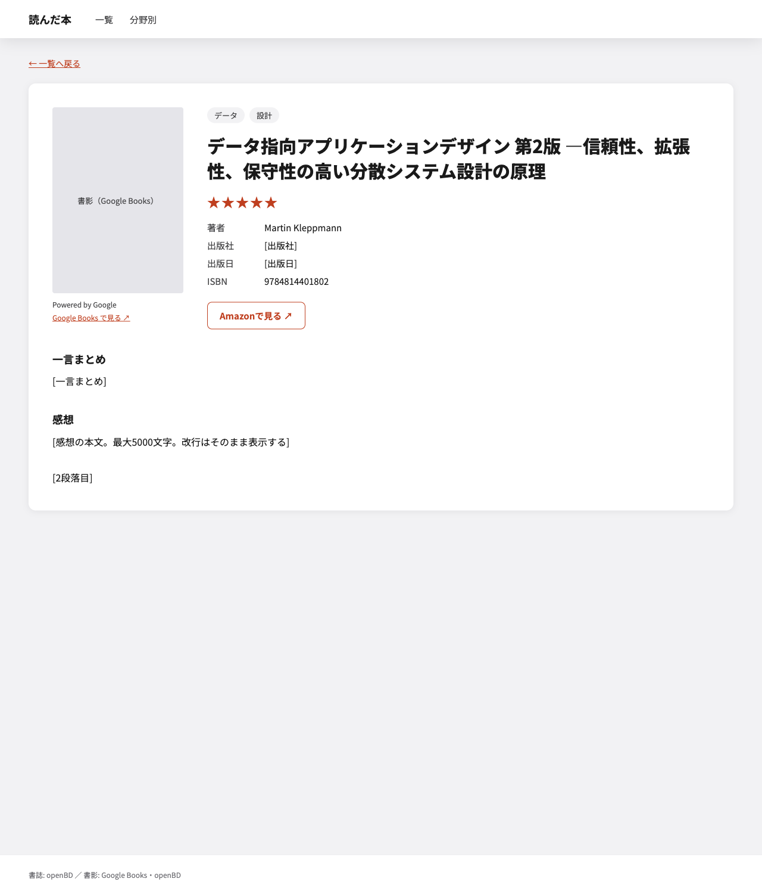
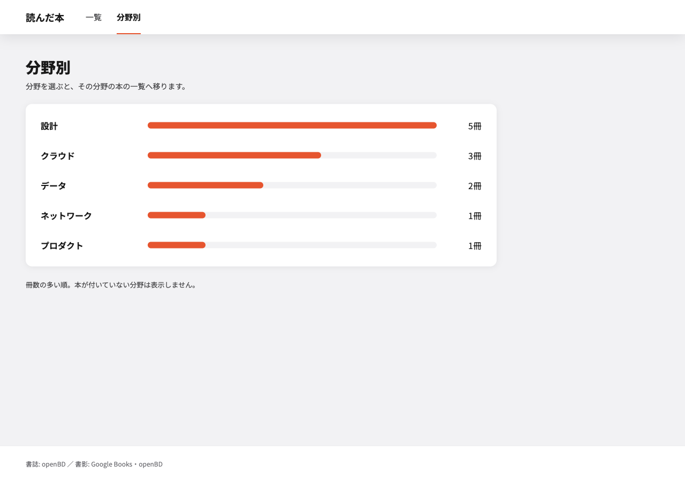

# 公開画面 概要設計

<!-- 書き方は _template.md。実装済みの機能を後追いで設計書にしたもの。モック・要件・コードから確認できる事実だけを書き、確認できないものは「未決」と書く -->

| | |
|---|---|
| 対象要件 | [`docs/specifications.md`](../specifications.md) §1・§2 |
| 関連する設計 | [`2026-09-29-public-screens-design.md`](../superpowers/specs/2026-09-29-public-screens-design.md)・[`2026-09-28-book-list-search-design.md`](../superpowers/specs/2026-09-28-book-list-search-design.md)・[`2026-09-28-book-tags-design.md`](../superpowers/specs/2026-09-28-book-tags-design.md) |
| モック | [`docs/design/public-screens/`](./public-screens/README.md) |
| Updated | 2026-11-02 |

---

# 必須

## 1. カスタマージャーニー

| 段階 | ユーザーがしたいこと | 操作する画面 | 気持ち・つまずきやすい点 |
|---|---|---|---|
| 眺める | 何を読んできた人か、ざっと知りたい | 一覧 | 冊数が多いと全部は見ない。書影と一言まとめで拾い読みする |
| 探す | 気になる分野・著者の本があるか知りたい | 一覧（検索・絞り込み）・分野別の集計 | 条件に合う本が無いときに、次に何をすればよいか分からないと離脱する |
| 読む | 1 冊についての感想・評価を読みたい | 詳細 | 感想が長いので改行が保たれていないと読みにくい。Amazon で中身を確かめたい |

## 2. 画面遷移図

読み込みに失敗した画面は、同じ画面にエラーの表示と「再試行」を出し、押すと取り直す（要件 §2.4）。

## 3. 権限

公開画面は認証なし。書き込みの操作は無い。

| 画面・項目・操作 | ゲスト | 自分（ログイン済み） |
|---|---|---|
| 一覧・詳細・分野別の集計の表示 | 閲覧 | 閲覧（公開画面のヘッダーから管理画面へのリンクは置かない） |

## 4. 画面と入出力項目

### 4-1. 一覧

*モック `list.html` / 通常表示。番号は図に無い。表の No. は項目の並び順*

*モック `list-mobile.html` / 幅 390。1 列になり、分野タグは横にスクロールする*

| No. | 項目名 | 対応データ | 入力制御 | 表示桁数 | 入力桁数★ | データ型★ | 文字種★ | 入力制約★ | 初期表示 | 出力仕様 | 必須★ |
|---|---|---|---|---|---|---|---|---|---|---|---|
| 1 | 冊数 | 条件に合う総件数（API の `total`） | - | - | - | - | - | - | 全件の冊数 | 「読んだ本 N冊」 | - |
| 2 | キーワード（書名・著者） | book.title / book.title_override / book.authors（部分一致） | 前後の空白を除く。空なら検索しない。URL の `q` を正にする | - | 100 | 文字列 | タブ・改行は不可 | - | URL の `q`（無ければ空） | - | 任意 |
| 3 | 検索 | - | 送信で `q` を URL に反映し、先頭から読み直す | - | - | - | - | - | - | - | - |
| 4 | 分野タグ（絞り込み） | tag.id（`tagId`） | ボタン群。「すべて」で外す。URL の `tag` を正にする。数値でない・1 未満なら絞り込みなし | - | - | 整数 | - | 1 以上 | URL の `tag`（無ければ「すべて」） | タグ一覧の取得に失敗してもボタン群だけ出さず、本の一覧は出す | 任意 |
| 5 | 本のカード | book.cover_url / book.title（上書きがあれば title_override）/ book.authors / book.summary / book.rating / tag.name（付いている分野タグ） | カード全体が詳細へのリンク | 一言まとめは 2 行を超えたら省略（モック） | - | - | - | - | 新しく登録した順に 20 冊 | 書影が無ければ「書影なし」の枠。評価は ★ と ☆ で 5 段階、読み上げは「評価 N / 5」 | - |
| 6 | N冊中 M冊を表示 / もっと見る | - | 読み込んだ冊数が総件数以上になったら「もっと見る」を出さない | - | - | - | - | - | - | - | - |

**状態**

| 状態 | 見え方 | 押せるもの・次にできること | モックでの出し方 |
|---|---|---|---|
| 最初の読み込み中 | 「読み込み中…」 | - | `states.html` 上段 |
| 追加の読み込み中 | 一覧の末尾に「続きを読み込み中…」。「もっと見る」は押せない | - | `states.html` |
| 本が 1 冊も無い | 「まだ本が登録されていません」 | - | `states.html` |
| 検索・絞り込みの結果なし | 「条件に当てはまる本はありません。キーワードを変えるか、分野タグを「すべて」に戻してください。」 | 「検索と絞り込みを外す」で `/` へ | `states.html` |
| 読み込み失敗 | 「本の一覧を読み込めませんでした」と FE 共通の文言 | 「再試行」で取り直す | `states.html` |

### 4-2. 詳細

*モック `detail.html` / 通常表示。番号は図に無い。表の No. は項目の並び順*

| No. | 項目名 | 対応データ | 入力制御 | 表示桁数 | 入力桁数★ | データ型★ | 文字種★ | 入力制約★ | 初期表示 | 出力仕様 | 必須★ |
|---|---|---|---|---|---|---|---|---|---|---|---|
| 1 | 一覧へ戻る | - | `/` へ | - | - | - | - | - | - | - | - |
| 2 | 書影 | book.cover_url | - | - | - | - | - | - | - | 無ければ「書影なし」の枠。画像は提供元の URL をそのまま使う | - |
| 3 | 分野タグ | tag.name | - | 全文 | - | - | - | - | - | 付いていなければ出さない | - |
| 4 | 書名 | book.title_override があればそれ、無ければ book.title | - | 全文 | - | - | - | - | - | - | - |
| 5 | 評価 | book.rating | - | - | - | - | - | - | - | ★ と ☆ で 5 段階 | - |
| 6 | 著者・出版社・出版日・ISBN | book.authors / publisher / published_on / isbn | - | 全文 | - | - | - | - | - | 値が無い項目（出版社・出版日）は行ごと出さない | - |
| 7 | Amazonで見る | ISBN から導出（保存しない） | 別タブで開く（`rel="noopener noreferrer"`） | - | - | - | - | - | - | ISBN-10 にできる本だけ出す | - |
| 8 | 一言まとめ | book.summary | - | 全文 | - | - | - | - | - | - | - |
| 9 | 感想 | book.comment | - | 全文 | - | - | - | - | - | 改行をそのまま表示する | - |

**状態**

| 状態 | 見え方 | 押せるもの・次にできること | モックでの出し方 |
|---|---|---|---|
| 読み込み中 | 「読み込み中…」 | - | `states.html` |
| 存在しない本（404） | 「この本は見つかりませんでした」「削除されたか、URL が間違っている可能性があります。」 | 「一覧へ戻る」 | `states.html` 下段 |
| 読み込み失敗（404 以外） | FE 共通のエラー表示 | 「再試行」 | `states.html` |

### 4-3. 分野別の集計

*モック `counts.html` / 通常表示。番号は図に無い。表の No. は項目の並び順*

| No. | 項目名 | 対応データ | 入力制御 | 表示桁数 | 入力桁数★ | データ型★ | 文字種★ | 入力制約★ | 初期表示 | 出力仕様 | 必須★ |
|---|---|---|---|---|---|---|---|---|---|---|---|
| 1 | 分野の行（名前・冊数・棒） | tag.name / book_tag の件数 | 行全体が `/?tag=<id>` へのリンク | - | - | - | - | - | 冊数の多い順（同数ならタグ名順） | 本が付いていない分野は出さない。棒の長さは最大冊数に対する割合（飾り。冊数は文字で出す） | - |

**状態**

| 状態 | 見え方 | 押せるもの・次にできること | モックでの出し方 |
|---|---|---|---|
| 読み込み中 | 「読み込み中…」 | - | `states.html` |
| 0 件 | 「分野タグの付いた本はまだありません」 | - | 設計文書の「0件の文言」（モックには無い） |
| 読み込み失敗 | FE 共通のエラー表示 | 「再試行」 | `states.html` |

## 5. メッセージ一覧

公開画面の文言はすべてモック・設計文書（上の「状態」の表）どおりで、FE の共通の文言（読み込み失敗・通信失敗）以外に機能固有のメッセージは無い。入力チェックの違反は画面に出さない（`q` が 100 文字を超えると API は 400 を返すが、画面は検索欄に文字数の上限を設けていない。未決: 画面で上限を伝えるか）。

## 6. テーブル構成

使う既存テーブル: [docs/db/backend-schema.md](../db/backend-schema.md) の `book`、`tag`、`book_tag`。新規・変更は無い。

## 7. CRUD 表

| 操作 | book | tag | book_tag |
|---|---|---|---|
| 一覧（`GET /api/books`） | R | R | R |
| 分野タグのボタン群（`GET /api/tags`） | - | R | - |
| 詳細（`GET /api/books/{id}`） | R | R | R |
| 分野別の集計（`GET /api/tags/counts`） | - | R | R |

---

# 条件付き

## 一覧の並び順・ページング・検索条件

| 画面 | 並び順 | 1 回の件数 | 検索・絞り込み条件 | 0 件のとき |
|---|---|---|---|---|
| 一覧 | 新しく登録した順 | 20 冊（API は `limit` 1〜100・既定 20、`offset`） | `q`（書名（上書きがあれば上書き）・著者の部分一致、大文字小文字を区別しない、前後の空白を除いて 100 文字以内）と `tagId`（1 以上）。両方を満たす本。存在しない `tagId` は 0 件 | 本が無ければ「まだ本が登録されていません」、条件に合わなければ「条件に当てはまる本はありません。…」と「検索と絞り込みを外す」 |
| 分野別の集計 | 冊数の多い順（同数ならタグ名順） | 全件 | なし | 「分野タグの付いた本はまだありません」 |

- `q`・`tag` が変わると先頭から読み直す（要件 §2.1）
- 次の `offset` は「読み込んだ冊数」。総件数以上なら読み込まない
