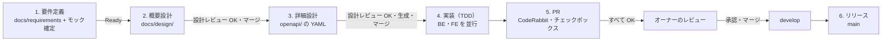

# 開発の流れ

要件定義からリリースまでを 1 本につないだ流れ。各段階の細かい規則は、表の「正」の文書に従う。本書は段階のつながり（何ができたら次へ進むか）だけを定める。

## 段階ごとのまとめ

| 段階 | やること | 成果物（置き場） | 次へ進む条件 | 正 |
|---|---|---|---|---|
| 1. 要件定義 | 要件を決め、ストーリーと受け入れ条件にする。**画面が必要なものはモックも同時に確定させる** | `docs/requirements/status-map.md`、GitHub Issue（ラベル `論点`）、`mock/<機能>/v<n>/` | ストーリーが **Ready**（目的・受け入れ条件がある、関連する未決の論点が無い、画面が必要なら確定したモックがある） | [`docs/requirements/PROCESS.md`](../requirements/PROCESS.md)・[`AGENTS.md`](../../AGENTS.md) |
| 2. 概要設計 | 確定したモックをもとに、画面・データ・外部連携の仕様を決める（下記） | `docs/design/<機能>.md`（画像は `docs/design/<機能>/images/`） | 設計レビューで OK になり、`develop` にマージ済み | 本書・[`docs/design/_template.md`](../design/_template.md) |
| 3. 詳細設計 | 業務領域・UseCase・PR の分け方を決め、API の IN・OUT・相関バリデーションを OpenAPI で定義する。合意したら BE・FE の生成物を作る（下記） | `openapi/<area>/<channel>/`（+ バンドル `openapi/dist/`・BE と FE の生成物） | Draft PR での設計レビューで OK になり、生成物を足して `develop` にマージ済み | [`docs/architecture.md`](../architecture.md) §4・[`backend/architecture.md`](../../backend/architecture.md)・[`frontend/architecture.md`](../../frontend/architecture.md) |
| 4. 実装 | BE・FE を並行して、テストから書く（TDD）。BE は Domain → 残りの層 → 相関バリデーションの順に PR を分ける（3. の「業務領域・UseCase・PR の分け方」） | コードとテスト | 自動テストと CI がすべて通る | [`docs/rules/testing.md`](./testing.md) |
| 5. PR | CI を通し、CodeRabbit の指摘に対応し、PR の確認事項のチェックボックスをすべて埋める。**すべて OK になってからオーナーへレビュー依頼** | PR | オーナーの承認 → `develop` へマージ、ブランチ削除、関連する Issue を閉じる | [`docs/rules/git-pull-request.md`](./git-pull-request.md) |
| 6. リリース | `develop` を `main` へマージする（緊急時は `hotfix/*`） | `main` | — | [`docs/rules/git-branch.md`](./git-branch.md) |

## 1. 要件定義

- 正本は `docs/requirements/status-map.md` と、ラベル `論点` の GitHub Issue。進め方は `PROCESS.md`
- **モックは要件と一緒に確定させる**。確定した版が画面の正本になる（`mock/<機能>/v<n>/`。作り方は `AGENTS.md` の Mocks）。確定していないモックのまま Ready にしない
- 進み具合は GitHub の Issue と PR で追い、`status-map.md` の進み具合の欄を更新する

## 2. 概要設計

Ready のストーリーから、確定したモックをもとに、画面・データ・外部連携の仕様を決める。書き方は [`docs/design/_template.md`](../design/_template.md) に従う。

- 置き場: `docs/design/<機能>.md`。`<機能>` は `mock/<機能>/` と同じ名前にする。画像は `docs/design/<機能>/images/`
- 形式: Markdown と Mermaid。1 機能 1 ファイルにまとめ、ストーリー・論点（Q-xxx）・モックの版とリンクする
- 画面ごとに、通常表示のスクリーンショットと入出力項目一覧を同じファイルで並べ、画像の番号と表の No. を対応させる
- 状態ごと（0 件・操作できない・入力エラー・システムエラーなど）の見え方は画像にせず、画面ごとの「状態」の表に、見え方・押せるもの・モックでの出し方を書く。状態の見た目の正はモックで、撮り直す画像を通常表示だけにするため
- レビュー: `docs/design/` だけの PR で設計レビューを受ける。OK になったら 5. の流れ（CI・CodeRabbit・確認事項 → オーナーのレビュー・承認）で `develop` にマージしてから、3. 詳細設計に進む（OpenAPI の制約・相関ルールの転記元をマージ済みの版に固定するため）。確認事項のうちコードに関するもの（バックエンド・フロントエンドの自動テスト、ローカルでの動作確認）は対象外で、N/A と書く

| 区分 | 書くこと |
|---|---|
| 必須 | カスタマージャーニー・画面遷移図（エラー時の遷移先を含む）・権限・画面と入出力項目（通常表示の番号付き画像と状態の表）・メッセージ一覧・テーブル構成（新規・変更の案）・CRUD 表 |
| 条件付き | アーキテクチャ図（簡単な API 以外）・外部連携の取り決め・状態遷移図と同時実行・冪等の方針・画面アクション定義（認証など複雑な処理）・一覧の並び順・ページング・検索条件・相関ルール（複数の項目・レコードにまたがる、業務上あってはならない状態と、システム観点でも重大になりうる規則） |

### 正の線引き

| 情報 | 正 |
|---|---|
| 画面の見た目・文言・状態別の表示 | 確定したモック |
| 入力桁数・データ型・文字種・入力制約・必須（1 つの項目で完結する制約） | 概要設計で決め、詳細設計で OpenAPI に転記する。転記後は OpenAPI |
| 複数の項目・レコードにまたがる規則（相関ルール） | 業務上あってはならない状態（例: 同じ ISBN の本が 2 冊登録される）と、システム観点でも重大になりうるものは概要設計の「相関ルール」で決め、詳細設計で OpenAPI の `x-correlation-rules` に転記する。転記後は OpenAPI。それ以外のシステムとして担保する規則（例: 分野タグの ID に重複が無い）は概要設計に書かず、OpenAPI にだけ書く |
| メッセージの文言 | 制約の種類ごとの共通のもの（「〇〇を入力してください」など）は FE の実装で、概要設計には書かない。機能に固有のもの（相関ルール・業務ルールの違反・確認・完了）は概要設計のメッセージ一覧（モックに出るものはモックから書き写す）。詳細設計だけで決めた相関ルール・業務ルールの違反のものは OpenAPI（3. 詳細設計） |
| 入力制御・表示桁数・初期表示・出力仕様 | 概要設計 |
| テーブル・カラム | 概要設計では案。migration のマージ後は `backend/migrations/*.sql`（`docs/db` は副次資料。概要設計の該当節は両方へのリンクに置き換える） |

### 更新

実装やモックの版上げで内容が変わったら、同じ PR で `docs/design/<機能>.md` も更新する。モックの変更で通常表示の画像と食い違ったら、同じ PR で撮り直す。版ごとのフォルダは作らず、git の履歴で管理する。

概要設計の検討中に決まったことは、上の「正の線引き」に従ってそれぞれの正に書く。画面の見た目・文言・状態別の表示が変わるものは、モックの同じ版へ反映する。

## 3. 詳細設計（OpenAPI）

API の契約を `openapi/` の YAML で定義する。これが BE・FE の生成と実装・テストの正になる（[`docs/architecture.md`](../architecture.md) §4）。

### 業務領域・UseCase・PR の分け方

OpenAPI を書き始める前に、業務領域（`internal/<area>`）と UseCase の分け方、Command（更新）か Query（参照）か、PR の分け方を決める。OpenAPI の置き場 `openapi/<area>/<channel>/` が業務領域で決まるため。

PR は次の順に出す。1 がマージされたら、BE と FE は並行して進める。

| 順 | PR | 中身 |
|---|---|---|
| 1 | 詳細設計 | `openapi/` の YAML・バンドル（`openapi/dist/`）・BE（oapi-codegen）と FE（Orval）の生成物。すでに `cmd` があるチャネルに operation を足すときは、未実装のスタブも置く（下記） |
| 2 | BE: Domain | VO・Entity・Repository IF と Domain のテスト（Domain で守る相関ルールを含む）。業務ルールを HTTP・DB の差分に埋もれさせずにレビューするため |
| 3 | BE: 残りの層 | UseCase・Infrastructure・Presentation・`cmd` の組み立てと、Presentation のテスト（ステータスごと・YAML に書いた入力の制約）。スタブがあれば消す |
| 4 | BE: 相関バリデーション | UseCase で実装する相関ルール（`x-correlation-rules`）とそのテスト。UseCase で実装する相関ルールが無ければ出さない |
| — | FE | 1 のマージ後、画面・hook を BE と並行して実装する（API は生成された MSW ハンドラで差し替えて作れる） |

- 取得・保存が中心で業務ルールが薄い機能は、2〜4 を 1 つの PR にまとめてよい。そのときはコミットを層ごと（Domain → UseCase → Infrastructure → Presentation）に分け、レビュアーが Domain から順に読めるようにする
- 1 を Handler より先にマージできるのは、CI `Test Presence` が Handler のまだ無い operation を BE のテストの検査から外すため（[テスト規約「テストの有無の検査」](./testing.md#テストの有無の検査ci-test-presence)）
- **すでに `cmd/<service>` があるチャネルに operation を足すとき**: `cmd` の `var _ <channel>api.ServerInterface = (*server)(nil)` で、Handler の無い operation があるとコンパイルが通らない。1 の PR で `cmd/<service>/unimplemented.go` に、足した operation のメソッドを `server` に定義し `echo.ErrNotImplemented`（501）を返すスタブを置く。3 の PR でこのスタブを消して Handler を `server` に埋め込み、`cmd/<service>/main_test.go` でそのルートが Handler を通って応答することを確かめる（スタブが残ると `server` のメソッドが埋め込んだ Handler のメソッドより優先され、コンパイルは通ったまま 501 を返し続けるため）。生成 IF を埋め込んで未実装を隠す形は採らない（[`backend/architecture.md`](../../backend/architecture.md) §3）

### API の定義

| 定義すること | 書き方 | 検証する場所 |
|---|---|---|
| IN（path・query・body） | パラメータ・`requestBody` のスキーマ。`required`・型・長さ・範囲・`enum` | OpenAPI の検証 middleware（自動。400）。YAML に書いた制約が受け入れ条件と概要設計の入出力項目一覧（★ 列）どおりかは、制約 1 つにつき通る値と弾かれる値を Presentation のテストで検証する |
| OUT（レスポンス） | 実際に返すステータスごとのスキーマ（成功・エラー） | Presentation のテスト（実際の DB）で spec に照らして検証 |
| 相関バリデーション（複数の項目・レコードにまたがる規則。例: 登録する ISBN の本は未登録である、分野タグの ID に重複が無い） | operation かスキーマに拡張フィールド `x-correlation-rules` で規則（`id`・内容・違反時の `field`・`message`・`params`）を列挙する。内容は**常に真になる条件**として、実装に寄せて書く（例: 概要設計の「同じ ISBN の本が 2 冊登録される」→「登録する ISBN の本は未登録である」）。概要設計の相関ルールはすべて転記し、`message` に概要設計のメッセージの ID（`MSG-xx`）を書く。システムとして担保するだけの規則はここにだけ書き、`id` は lowerCamel（例: `tagIdsDuplicated`）、`message` に文言を直接書く（[`frontend/architecture.md`](../../frontend/architecture.md) §4 の 4 つの鉄則を守る） | OpenAPI 3.0 には標準の書き方が無く、ツールは自動で検証しない。Domain（VO・Entity）か UseCase で実装し、規則ごとにテストを書く。違反は 400 の `ErrorResponse` で、`errors[{field, rule}]` の `rule` に規則の `id` を載せる（[`docs/architecture.md`](../architecture.md) §4） |
| 業務ルールの違反（対象が存在しない・版の競合など。4xx） | operation に拡張フィールド `x-error-codes` で、返すコード（`code`・ステータス・`message`・`params`）を列挙する。`code` は lowerCamel（例: `bookNotFound`）。`message` は概要設計のメッセージの ID（`MSG-xx`）か、詳細設計だけで決めたものなら文言。`params` は文言に差し込む値のキーと型（例: `retryAfterSeconds: integer`） | Presentation のテストで、ステータスごとに `ErrorResponse` の `code` と `params` を検証する |

- 詳細設計のレビューは、`openapi/` の差分だけを先に **Draft PR** で出し、設計レビューとして受ける。これは 5. の「マージ前のレビュー依頼」とは別で、CI・チェックボックスが揃う前に依頼してよい。合意したら、同じ PR で BE・FE の両方の生成物を作り（新しいチャネルなら BE の `backend/api/gen/<channel>/config.yaml`・`backend/Makefile` の生成の対象と、FE のアプリの `orval.config.ts`・`gen:api` も足す）、5. の流れでマージする。これで詳細設計は完了になる。FE のアプリがまだ無いチャネルは、生成物の置き場が無いため、先にアプリの土台（ビルド・テスト・CI の設定）の PR を出してマージしておく
- FE の生成物（Orval）も同じ PR で再生成する（`openapi/dist/` が変わると Frontend CI の生成差分検査が走り、FE を再生成していないと失敗するため）。生成物を使う画面・hook の実装は別の PR で行う
- 入力・相関バリデーションは独立して判定できる違反をすべて 400 で返す。件数上限・重複登録・入力欄のない `field` の扱い、判定不能時の境界は [`docs/architecture.md`](../architecture.md) §4「バリデーションの全件返却」に従う
- 業務ルールは OpenAPI の検証だけに頼らず Domain でも保証する（[`backend/architecture.md`](../../backend/architecture.md) §3）

## 4. 実装（TDD）

- 設計の Draft に実装を追加する前に、AI が「通常の実装 / 重要な実装」を理由付きで提案し、人が選び直す。分類ラベルと PR 本文を更新する（[PR 運用ルール](./git-pull-request.md)）。設計時の未実装・テスト未追加の免除は実装段階へ持ち越さない
- 順番は **仕様 → テスト → 実装**。テストは受け入れ条件・概要設計（入出力項目一覧の ★ 列・相関ルール）・OpenAPI（IN・OUT・相関バリデーション）から書き、実装の今の動きから書かない（この順番の規則は本書が正。テストの書き方・置き場は [テスト規約](./testing.md)）
- BE・FE とも、生成物を使う側（Handler・hook・画面）のテストは必須（[テスト規約](./testing.md)）。テストの有無は CI `Test Presence` が検査する。BE は Handler のある operation ごとの Presentation のテスト、FE はアプリが使っている operation の MSW ハンドラを使うテストが無いと失敗し、変更したソースと同じディレクトリのテストが変わっていなければ警告する（条件の詳細は [テスト規約「テストの有無の検査」](./testing.md#テストの有無の検査ci-test-presence)）
- 実装中に `openapi/` の変更（と、それに伴う生成物の変更）が必要になったら、実装の PR では変えず、詳細設計に戻る。変更は詳細設計の PR として別に出し（Draft で設計レビュー → BE・FE を再生成 → マージ。3. 詳細設計の手順と同じ）、マージ後に実装の PR へ `develop` を取り込む。生成物は BE と FE の両方が使う契約で、実装の PR に紛れると設計レビューを通らないため。説明文の誤字や制約の転記ミスのような小さな直しも同じにする（契約を直す PR を待つ間も、実装は進めてよい）
- その変更が概要設計に書いたこと（入出力項目の制約・相関ルール・メッセージ）に関わるなら、先に概要設計を更新する（2. 概要設計）。戻る先は、変更の元になっている段階にする

## 5. PR

1. AI がレビュー分類と理由を提案し、人が決定する。決定後に Draft PR を作り、分類ラベルを 1 つ付けて確認する。設計は Draft のまま、実装は準備完了後に Ready にする（分類・再レビュー手順は [PR 運用ルール](./git-pull-request.md)）
2. CI をすべて通す
3. CodeRabbit の指摘に対応する（1 指摘 1 コミット、スレッドに返信）
4. PR の「確認事項」のチェックボックスをすべて埋める（ローカルで確認した内容を具体的に書く）
5. **2〜4 がすべて OK になったら、オーナーにレビューを依頼する**（それより前に依頼しない）
6. 承認されたらマージし、ブランチを削除する。ストーリーが完了したら関連する Issue を閉じ、`status-map.md` の進み具合を更新する

## 6. リリース

`develop` に集めた変更を `main` へマージする。緊急の修正は `main` から `hotfix/*` を切り、`main` と `develop` の両方へ反映する（[ブランチ運用ルール](./git-branch.md)）。
