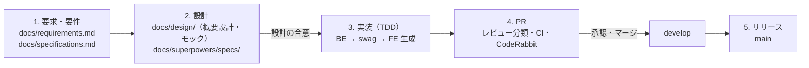

# 開発の流れ

要求からリリースまでを 1 本につないだ流れ。各段階の細かい規則は、表の「正」の文書に従う。本書は段階のつながり（何ができたら次へ進むか）だけを定める。

## 段階ごとのまとめ

| 段階 | やること | 成果物（置き場） | 次へ進む条件 | 正 |
|---|---|---|---|---|
| 1. 要求・要件 | 誰に何を伝えるために作るか（要求）と、システムと開発の進め方が満たすこと（要件）を決める | [`docs/requirements.md`](../requirements.md)・[`docs/specifications.md`](../specifications.md) | 要件が「満たしたかどうか」を確かめられる形で書かれている | 各文書 |
| 2. 設計 | 機能ごとに画面・データ・外部連携の仕様と実装計画を決める。画面が要るものは HTML モックで見え方を先に決める | 機能ごとの設計 `docs/superpowers/specs/`、画面モック `docs/design/`、実装計画 `docs/superpowers/plans/`。機能をまたぐ判断の理由は、その規則を持つ文書の該当箇所 | 設計が合意され（必要なら `review:design` の Draft PR でレビュー）、要件と食い違いが無い | [`docs/architecture.md`](../architecture.md)・[`backend/architecture.md`](../../backend/architecture.md)・[`frontend/architecture.md`](../../frontend/architecture.md) |
| 3. 実装 | テストから書く（TDD）。BE は Go の DTO／Handler が契約の正で、`make swagger` で OpenAPI を排出し、FE は `pnpm gen:api` で生成物を更新する | コードとテスト、生成物（`backend/api/docs/`・`frontend/web/src/api/generated/`） | 自動テストと CI（`Test Presence` を含む）がすべて通る | [`docs/rules/testing.md`](./testing.md)・[コメントの書き方](./code-comments.md) |
| 4. PR | レビュー分類を人が決め、Draft で作成 → CI → CodeRabbit の指摘に対応 → 確認事項を埋めて Ready → レビュー依頼 | PR | 承認 → `develop` へマージ、ブランチ削除 | [`docs/rules/git-pull-request.md`](./git-pull-request.md) |
| 5. リリース | `develop` を `main` へマージする（緊急時は `hotfix/*`） | `main` | — | [`docs/rules/git-branch.md`](./git-branch.md) |

## 1. 要求・要件

- 要求は [`docs/requirements.md`](../requirements.md)、要件は [`docs/specifications.md`](../specifications.md)。文字数などの細かい上限は、各機能の設計で決めて要件に足す
- 要件のあいまいさを実装の都合だけで決めない。決めたことは要件に書き戻す

## 2. 設計

- 機能ごとの設計は `docs/superpowers/specs/<日付>-<機能>-design.md`、実装計画は `docs/superpowers/plans/`。機能スコープの判断はその設計文書の中に書き、機能をまたぐ判断（ライブラリ・インフラなど）は、その規則を持つ文書（`docs/architecture.md`・`backend/architecture.md`・`frontend/architecture.md`・`docs/rules/*.md`）の該当箇所に「採用理由」「採らなかった案」として書く
- 概要設計は `docs/design/<機能>.md`（テンプレート [`docs/design/_template.md`](../design/_template.md)）。画面が要る機能は、同じディレクトリの HTML モック `docs/design/<機能>/` で見え方・文言・状態（0 件・エラー）を先に決める。入力の制約（★ 列）と相関ルール（CR-xx）・メッセージ（MSG-xx）はここで決め、詳細設計に転記する。モックのコードを本番コードへ流用しない
- 設計だけを先にレビューしたいときは、設計文書だけの Draft PR を `review:design` で出す（[PR 運用ルール](./git-pull-request.md)）

## 3. 実装（TDD）

- 順番は **仕様 → テスト → 実装**。テストは要件・設計から書き、実装の今の動きから書かない（テストの書き方・置き場は [テスト規約](./testing.md)）
- 詳細設計は別の文書ではなく、Request DTO の `validate` タグ・Domain VO・Handler の swag コメント（相関ルールの `@x-correlation-rules` を含む）そのもので、`make swagger` が契約（`backend/api/docs/swagger.yaml`）を排出する。相関ルールは UseCase に実装し、規則ごとにテストする（[テスト規約](./testing.md)）
- BE は Domain → UseCase → Infrastructure → Presentation の順にコミットを分け、レビュアーが Domain から順に読めるようにする（業務ルールを HTTP・DB の差分に埋もれさせないため）
- API の契約（DTO・Handler・swag コメント）を変えたら、同じ PR で `make swagger` と `pnpm gen:api` を実行し、生成物も含めてコミットする（CI のドリフト検査が落ちるため）。生成物は手編集しない
- FE は生成した hook を feature の hook から呼び、API の差し替えは生成 MSW ハンドラで行う
- テストの有無は CI `Test Presence` が検査する（API があるのにテストが無ければ失敗、変更したソースの同じディレクトリにテストの変更が無ければ警告）
- 実装中に要件・設計と食い違いを見つけたら、コードで辻褄を合わせず、先に要件・設計を直す（戻る先は、食い違いの元になっている段階）

## 4. PR

1. AI がレビュー分類と理由を提案し、人が決定する。決定後に Draft PR を作り、分類ラベルを 1 つ付ける
2. CI をすべて通す
3. CodeRabbit の指摘を吟味して対応する（1 指摘 1 コミット、スレッドに返信）
4. PR の「確認事項」のチェックボックスをすべて埋める（ローカルで確認した内容を具体的に書く）
5. 2〜4 がすべて OK になったら Ready にしてレビューを依頼する（それより前に依頼しない）
6. 承認されたらマージし、ブランチを削除する

## 5. リリース

`develop` に集めた変更を `main` へマージして公開する。緊急修正は `main` から `hotfix/*` を切り、`main` と `develop` の両方へ反映する（[ブランチ運用ルール](./git-branch.md)）。
